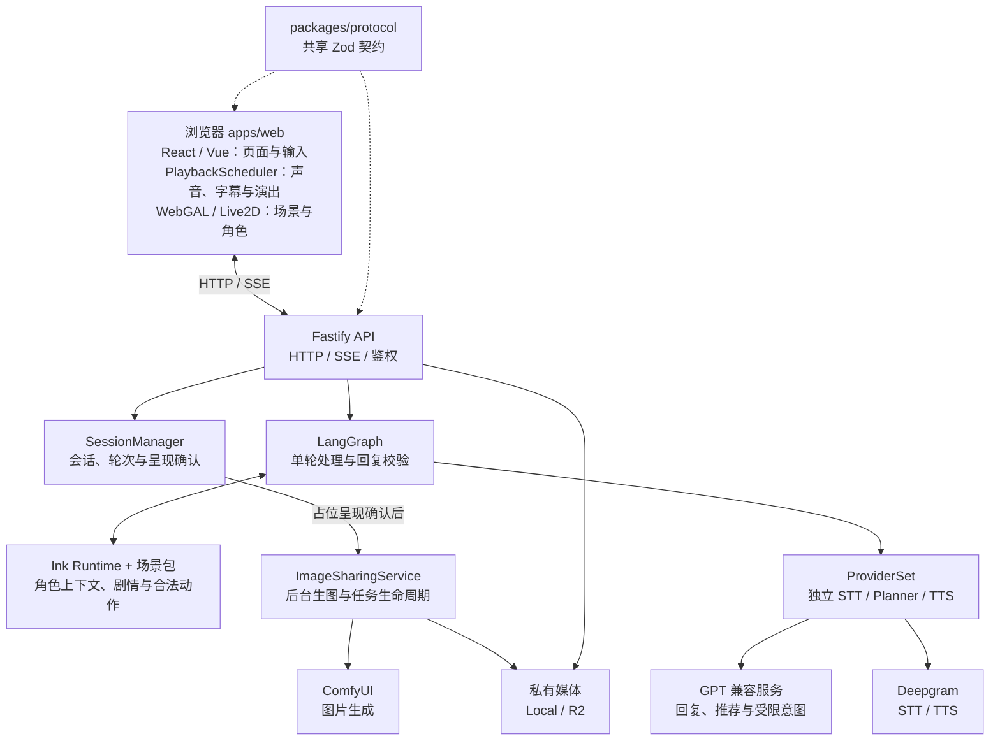
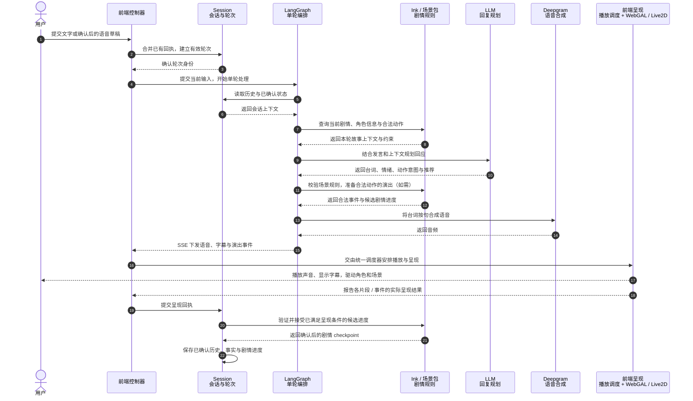
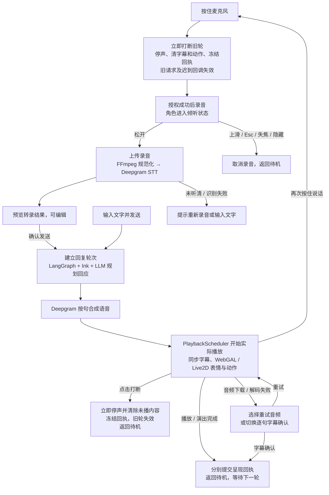
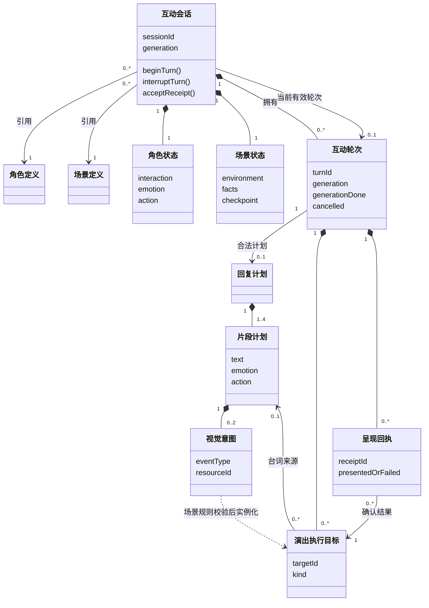

# 角色互动平台

一个以场景和角色为主体的移动端网页互动 MVP。用户可以通过文字或麦克风与成年角色交流，角色通过语音、字幕、Live2D 表情和动作回应，并随对话触发场景变化与图片分享。

当前内置咖啡馆故事《今晚没有返程》，支持持续对话、地点探索与剧情分支。故事身份、台词和场景资源由场景包提供，共享 UI、会话服务与协议承载平台能力。

## 在线演示

[故事页](https://72-mvp.telegrow.app/) · [原版对话页](https://72-mvp.telegrow.app/legacy.html) · [演示步骤](docs/acceptance/demo.md)

## 快速开始

### 环境要求

- Node.js **26.13.0**、npm **11.20.0**；nvm 用户先执行 `nvm install && nvm use`。
- FFmpeg，用于录音和图片处理；macOS 可执行 `brew install ffmpeg`，其他系统见[环境安装说明](docs/development/README.md)。

### 本地开发

在项目根目录执行：

```sh
npm ci
npm run dev
```

打开 [http://localhost:5173](http://localhost:5173)。默认故事页为 `/`，原版对话页为 `/legacy.html`，API 端口为 `3000`。

> **默认无需 API 密钥。** Mock 使用字幕、模拟识别和图片；真实语音及模型服务按 [Provider 配置](docs/provider-configuration.md)启用。

### Docker

仅需安装 Docker 与 Compose，无需另装 Node.js 或 FFmpeg：

```sh
docker compose --profile demo up --build -d
```

打开 [http://localhost:8080](http://localhost:8080)。停止服务：`docker compose --profile demo down`。更多部署说明见[部署文档](docs/operations/README.md)。

安装与启动的实际验证范围及未通过项见[启动验收记录](docs/development/README.md#2026-11-02-安装与启动验收)。

## 1. 系统结构和主要模块

| 主要模块       | 对应技术                                                         | 核心职责                                           |
| -------------- | ---------------------------------------------------------------- | -------------------------------------------------- |
| 工程基座       | TypeScript、ESM、npm workspaces                                  | 统一类型与依赖管理，前后端独立构建                 |
| 页面与输入     | React、Vue 3、Vite                                               | React 故事页与 Vue 原版对话页，共享交互控制器      |
| 场景演出       | WebGAL、PixiJS                                                   | 背景、地点切换、镜头和环境效果                     |
| 角色表演       | Live2D、Cubism、PixiJS                                           | 四态、表情、动作与实际音频驱动的口型               |
| **播放与打断** | MediaRecorder、Web Audio API、PlaybackScheduler、AbortController | 录音与预览，统一调度声音/字幕/演出，取消失效轮次   |
| HTTP 服务      | Node.js、Fastify、HTTP/SSE                                       | 鉴权、输入上传、事件下发与私有媒体访问             |
| **会话与状态** | SessionManager、内存状态、浏览器存储                             | 单轮所有权、呈现回执、剧情提交与有效会话恢复       |
| 对话编排与规划 | LangGraph、GPT 兼容接口                                          | 组织上下文、生成回复与推荐、校验及有限修复         |
| **场景包**     | Ink、inkjs、JSON、TypeScript 模块接口                            | 封装角色、Lore、剧情规则与前端呈现，按 ID/版本对齐 |
| 语音识别与合成 | Deepgram STT/TTS、FFmpeg                                         | 录音规范化、转录与句级语音合成                     |
| 后台图片生成   | ComfyUI、ImageSharingService                                     | 独立排队生成图片，管理取消、重试与就绪展示         |
| 私有媒体存储   | 本地文件系统、Cloudflare R2（S3 API）                            | 按会话管理音频/图片归属、容量与有效期              |
| 共享契约       | Zod、TypeScript、OpenAPI                                         | 前后端 DTO、事件、能力与回执的校验和接口文档       |



### 模块目录

模块按目录组织如下，标有 `核心` 的目录承担交互一致性或剧情控制：

```text
.
├── apps/
│   ├── web/src/                        # 前端：页面、用户输入与实际呈现
│   │   ├── app/                        # Vue 原版对话页
│   │   ├── webgal/
│   │   │   ├── product/                # React 故事页、菜单与状态展示
│   │   │   ├── runtime/                # WebGAL 舞台初始化与生命周期
│   │   │   ├── characters/             # Live2D 模型、参数、动作与口型驱动
│   │   │   └── scenes/                 # 场景模块接口
│   │   │       └── cafe/               # 场景包前端：背景、地点布局与呈现适配
│   │   ├── interaction/                # 核心：输入、轮次、打断、重试与回执协调
│   │   │   └── turn-controller.ts      # 两个页面共用的交互控制器
│   │   ├── playback/                   # 核心：声音、字幕与场景事件的唯一调度
│   │   │   └── scheduler.ts            # 按轮次播放、取消和确认实际呈现
│   │   ├── scene/                      # 原版 Live2D 舞台与加载器
│   │   ├── engine/webgal/              # 固定版本的 WebGAL 引擎实现
│   │   ├── connection/                 # 连接监测、心跳与恢复协调
│   │   └── persistence/                # 浏览器草稿、偏好、凭证与有限回看
│   └── server/src/                     # 后端：独立 Node / Fastify 服务
│       ├── app.ts                      # HTTP / SSE 路由、鉴权与依赖装配
│       ├── sessions/                   # 核心：会话、有效轮次和已确认剧情状态
│       │   └── manager.ts              # 根据呈现回执提交事实与 Ink checkpoint
│       ├── graphs/                     # 核心：LangGraph 单轮编排与回复校验
│       │   └── conversation.ts         # 识别、上下文、规划、校验与合成下发
│       ├── scenario/                   # 核心：剧情运行时与故事内容边界
│       │   ├── runtime/                # inkjs 适配、存档、上下文与通用校验
│       │   └── cafe/                   # 场景包后端：Ink、角色、Lore 与合法动作
│       ├── providers/                  # 独立 STT / Planner / TTS 接口及适配
│       ├── images/                     # 后台生图队列、ComfyUI、取消与重试
│       └── media/                      # 私有音频/图片校验、Local / R2 存储
└── packages/
    └── protocol/                       # 前后端共享的 Zod 网络契约与类型
```

### 场景包设计

场景包嵌入前后端工程，通过统一接口接入通用运行能力。下面只展开与场景包相关的目录：

```text
72-mvp-homework/
├── apps/server/src/                 # 后端工程
│   ├── scenario/
│   │   ├── index.ts                 # 选择并装配当前场景包
│   │   ├── ports.ts                 # 定义场景包接入接口
│   │   ├── runtime/                 # 通用 Ink 执行、上下文与校验
│   │   └── cafe/                    # 【场景包·后端】咖啡馆故事内容
│   │       ├── character.json       # 角色身份与说话风格
│   │       ├── lore.json            # 背景知识与道具内容
│   │       ├── manifest.json        # 场景声明、版本与资源绑定
│   │       ├── main.ink             # 剧情入口
│   │       ├── scenes/              # 各地点、章节的剧情与选择
│   │       └── image-sharing.json   # 当前故事的生图内容配置
│   ├── graphs/                      # 通用对话与模型调用流程
│   ├── sessions/                    # 通用会话、轮次与进度确认
│   └── providers/                   # 通用模型与语音服务适配
│
├── apps/web/src/                    # 前端工程
│   ├── webgal/
│   │   ├── main.tsx                 # 选择并装配当前场景模块
│   │   ├── product/                 # 通用故事页面与交互界面
│   │   └── scenes/
│   │       ├── module.ts            # 定义场景呈现接口
│   │       └── cafe/                # 【场景包·前端】咖啡馆呈现
│   │           ├── locations/       # 地点布局、人物位置与前景
│   │           ├── resources.ts     # 场景资源索引
│   │           ├── presentation.ts  # 背景、道具与环境演出
│   │           └── legacy.ts        # 原版 Vue 页的场景接入
│   ├── interaction/                # 通用输入、打断与回执协调
│   └── playback/                   # 通用声音、字幕与演出调度
│
└── packages/protocol/              # 前后端共享的协议与类型
```

> **两个 `cafe/` 目录共同构成咖啡馆场景包：后端提供故事与规则，前端提供画面与演出。**
> 工程通过 `ScenarioDefinition`、`SceneModule` / `LegacySceneModule` 接口装配场景包，前后端以场景 ID 和版本对齐。

场景包设计在既有平台能力范围内满足**高内聚**与**开闭原则**：

> **高内聚：同一故事的内容与呈现围绕场景组织。**
> 角色、人设、Lore、剧情、地点、资源绑定与演出适配集中在对应场景包中，故事迭代主要在包内完成；通用会话、播放和语音模块各自维护平台职责。
>
> **开闭原则：对场景扩展开放，对通用核心修改封闭。**
> 新增故事时增加对应场景包并在组合入口装配，新增地点时扩展包内剧情、资源和布局；已有会话、Graph 编排、播放调度与回执机制继续复用，无需为具体故事改写核心流程。

这一扩展边界以现有接口支持的能力为准；新增事件类型或渲染能力时，仍需显式演进协议与适配器。编译产物只向前端导出公开配置，完整 Lore、私有标记与存档保留在后端。具体约束见[场景模块边界](docs/architecture/scene-modules.md)。

### 一次请求的处理时序



[详细组件与时序](docs/architecture/program-interactions.md)

## 2. 语音交互与打断流程



## 3. 角色和场景指令的设计

### 领域关系（UML 概念模型）



### 指令约定

| 内容           | 主要字段 / 取值                                            | 来源与执行约束                                                   |
| -------------- | ---------------------------------------------------------- | ---------------------------------------------------------------- |
| 交互状态       | `idle / listening / thinking / speaking`                   | 由真实录音、处理与播放状态决定                                   |
| 台词与情绪     | `segments[].text / emotion`；戒备、好奇、释然              | 模型提议并校验；同一句文本用于语音和字幕                         |
| 角色动作       | `none / lookWindow / offerPhoto / acknowledge / focusProp` | 校验后的动作映射为模型参数；递照片由合法场景演出使用             |
| 剧情动作与推荐 | `actionId / actionRequest / suggestions`                   | 核对当前合法动作、用户输入证据与确认条件，推荐本身不推进剧情     |
| 场景事件       | 地点、照片、道具、环境、剧情段落、结局                     | Ink / 场景包产生，程序绑定资源和事件 ID                          |
| 主动生图       | `mediaDecision`：prepare / defer / dismiss / keep          | 场景包授权候选，模型选择有限意图，后台准备后交调度器展示         |
| 呈现结果       | `targetId / kind / status`                                 | 台词、图片与场景分别确认；取消冻结回执，成功呈现后才提交对应结果 |

[场景包与扩展约束](docs/architecture/scene-modules.md) · [指令与回执协议](docs/contracts/README.md) · [主动图片分享](docs/architecture/image-sharing.md)

## 4. 使用的模型、媒体方案和主要第三方服务

### 模型与服务

| 能力           | 当前方案                                     | 使用方式 / 配置                                                                     |
| -------------- | -------------------------------------------- | ----------------------------------------------------------------------------------- |
| 对话与规划     | **OpenAI 兼容 GPT Provider**                 | 在 LangGraph 内生成结构化回复与推荐；服务和模型由 `GPT_BASE_URL` / `GPT_MODEL` 指定 |
| 语音识别       | **Deepgram Nova-3**，默认 `zh-CN`            | 录音经 FFmpeg 转为 WAV 后识别；结果先进入可编辑草稿                                 |
| 语音合成       | **Deepgram Flux 中文音色**                   | 按句合成 MP3；实际音色由 `DEEPGRAM_MODEL` 指定                                      |
| 动态图片       | **ComfyUI** API 工作流                       | 按当前对话与场景授权准备纪念照；模型由 `COMFYUI_CHECKPOINT` 指定，后台任务独立运行  |
| 剧情引擎       | Ink / inkjs                                  | 场景包编写剧情，运行时提供上下文、合法动作与候选进度                                |
| 场景与角色渲染 | WebGAL / PixiJS + Live2D Cubism              | 背景、镜头、环境与角色共用舞台；默认 Haru，故事页可显式切换 Miara                   |
| 私有媒体       | LocalMediaStore；可选 Cloudflare R2          | 音频与生成图片按会话归属保存；R2 通过 S3 API 接入                                   |
| 部署           | Cloudflare Pages + 云服务器上的 Node / Nginx | Pages 托管前端，后端独立提供 HTTPS / SSE 和私有媒体接口                             |
| 无密钥演示     | Mock + Local                                 | 模拟识别、场景包回复、字幕与标记为“模拟”的图片；配置 Deepgram 后可使用真实语音      |

[Provider 配置](docs/provider-configuration.md) · [部署方式](docs/operations/README.md)

### 媒体与素材来源

| 素材                           | 来源与用途                                                                  | 来源 / 条款记录                                                                                                             |
| ------------------------------ | --------------------------------------------------------------------------- | --------------------------------------------------------------------------------------------------------------------------- |
| **Haru / Miara 角色模型**      | Live2D 官方样例，作为技术替身；原创成年角色的文字设定与样例视觉资产分别说明 | [Live2D 归属与条款](apps/web/public/assets/live2d/NOTICE.md)、[Miara 来源](apps/web/public/assets/live2d/miara/README.md)   |
| Cubism / Pixi 运行库           | 固定版本、同源加载；SDK、库代码与角色素材分别遵循对应条款                   | [运行库与素材清单](apps/web/public/assets/live2d/SOURCES.json)                                                              |
| WebGAL 引擎与资源              | 从固定上游提交导入，代码采用 MPL-2.0；字体及纹理按各自许可保留              | [上游来源与补丁](apps/web/third-party/webgal/README.md)                                                                     |
| **八个场景背景与三个打烊变体** | 使用 `gpt-image-2` 预先生成，打包为 WebP；运行时作为静态场景资源加载        | [生成与处理说明](apps/web/public/assets/cafe-story/README.md)、[来源与哈希](apps/web/public/assets/cafe-story/SOURCES.json) |
| 平台图标                       | 本项目绘制的 SVG 素材                                                       | [公开素材清单](apps/web/public/SOURCES.json)                                                                                |
| Mock 纪念照                    | 复用窗边背景的服务端副本，页面明确标注“模拟”                                | [模拟图片来源](assets/images/SOURCES.json)                                                                                  |
| Live 纪念照                    | ComfyUI 按授权的对话意图生成，保存在私有媒体中                              | [生成流程与验证范围](docs/architecture/image-sharing.md)                                                                    |

## 5. 关键技术选择与取舍

- 用按住说话替代 VAD 和自动打断，缩小实时音频范围并让用户明确控制录音。
- 使用逐句 REST 合成，方便让字幕、动作和实际播放对应；代价是首句等待会比全双工流式系统明显。
- 使用 Ink 管理跨地点剧情与结局，模型只提供受限的对话和建议；这降低自由生成对事实的控制，但不能保证所有自然语言都完全符合剧情语义。
- 将故事内容与前端呈现组织为场景包，复用平台会话、播放和回执能力；代价是新增内容需要维护两端资源绑定，并协调场景版本。设计见[场景包设计](#场景包设计)。

## 6. 已知问题

### 架构上

| 问题                                               | 当前情况与影响                                                                                                                                        | 改进方向（待实施）                                                                                                                               |
| -------------------------------------------------- | ----------------------------------------------------------------------------------------------------------------------------------------------------- | ------------------------------------------------------------------------------------------------------------------------------------------------ |
| **服务端业务数据未持久化**                         | Session、对话历史、Ink checkpoint，以及 LangGraph / LangChain 依赖的业务上下文主要保存在内存，服务重启后无法延续原有进度；当前也不支持多实例共享会话  | 先分析各类数据的形态、生命周期、恢复需求和一致性要求，再选择存储。会话、已确认事实与剧情存档需协调提交；媒体文件、任务记录和临时执行状态分别管理 |
| **场景包完成初步拆分，底层抽象与生命周期仍不完整** | 首版对照需求 PDF 实现时，场景业务与框架代码耦合较高；经人工干预逐步在文件与接口层拆分，形成场景包设计。底层基础代码仍需提炼，当前通过代码入口静态装配 | 抽象可复用的场景基础能力，定义包的元信息、能力与依赖；补齐加载、初始化、动态装卸、资源释放，以及版本兼容和存量会话的归属策略                     |
| **前端入口与公共代码仍需收敛**                     | 版本迭代保留了 React / WebGAL 与 Vue 多入口，页面状态、呈现适配、样式和配置仍有重复与硬编码                                                           | 逐步收敛入口和状态模型，提炼公共组件与交互能力，将角色、地点和资源差异继续归入场景配置                                                           |

[持久化设计草案](docs/architecture/session-persistence-design.md) · [场景包边界](docs/architecture/scene-modules.md)

### 业务上

**对白生成、剧情推进与关系发展存在割裂。** LLM 的普通对白、推荐回复与过细的 Ink 控制节点难以精准对应，容易出现推荐脱离上下文、聊了多轮却不知道如何推进的问题。

| 问题                               | 改进方向（待实施）                                                                                                              |
| ---------------------------------- | ------------------------------------------------------------------------------------------------------------------------------- |
| **普通对白受逐句关卡牵制**         | 普通对白统一由 LLM 承接；Ink 从逐句控制改为有目的的场景段落，规定当前事实、交流机会、关键事件和退出条件，允许同一段自由交流多轮 |
| **推进按钮与真实选择混在一起**     | 删除“继续初次认识”这类逐句推进按钮；保留“接受拼桌”“一起看风景画”“今晚先离开”等有实际含义的选择                                  |
| **关系变化依赖预设反应**           | 关系变化需要实际交流与明确选择作为依据；针对靠近、放慢、拒绝、停留或离开形成不同分支，不以固定轮数或点击下一句代替关系发展      |
| **旁白、心声和推荐的上下文不统一** | 普通对白、旁白、心声与推荐共用已确认历史、剧情事实和当前段落目的；同时区分角色私有想法与玩家实际获知的信息                      |

> **段落示例：窗边初识**
>
> - 双方刚认识，对彼此了解有限。
> - 可以聊咖啡、店里、下班后的琐事。
> - 有机会介绍姓名、交换一点个人信息。
> - 玩家愿意继续，才提出下一项活动。

[剧情与 LLM 分工调整草案](docs/architecture/llm-directed-story-design.md)

### 其他待完善项

| 范围           | 当前限制                                                                                           | 后续工作                                                                        |
| -------------- | -------------------------------------------------------------------------------------------------- | ------------------------------------------------------------------------------- |
| 角色资产与表演 | 当前使用官方 Haru / Miara 技术样例，原创角色视觉资产尚未交付；专用动作与跨姿态衔接仍受模型能力限制 | 制作正式角色资产，按实际参数与动作能力验收表情、口型、手势和过渡                |
| 语音与移动体验 | 当前为按住说话、转录确认和句级 TTS；真人麦克风完整链路、手机权限、系统键盘与后台恢复仍缺完整验收   | 优先完成真实设备与中文语音质量验证，再评估流式识别、VAD 与更自然的打断          |
| 生成图片质量   | 已有格式、大小与解码校验，但不能保证人物同脸、服装、手部和场景语义连续性                           | 补角色一致性方案、质量检测与受控重试；区分生成失败和图片展示失败                |
| 性能与调用成本 | 已有阶段日志与连接 RTT，但缺少真实端到端延迟、错误率和模型调用成本的统计基线                       | 采集小样本，分别衡量识别、规划、合成、生图及实际呈现等待                        |
| 验收与交付材料 | 专项验证不覆盖全仓回归，既有记录仍有失败项；长篇目标时长未实测，历史无音轨录屏也未覆盖当前全部改动 | 修复并验证全仓失败项，补真实设备与完整路线验收，准备当前版本的 3–5 分钟交付录屏 |

[需求逐项对照](docs/acceptance/todo-list.md) · [生图验证范围](docs/architecture/image-sharing.md) · [既有实施与验收记录](docs/acceptance/implementation-plan.md)

## 7. 大致投入时间

| 统计项             | 结果                                                                                       |
| ------------------ | ------------------------------------------------------------------------------------------ |
| **总体开发跨度**   | **约 60 小时（约 2.5 天）**                                                                |
| 首次需求与技术分析 | 2026-10-30 22:27                                                                           |
| 首次工程实现       | 2026-10-31 00:26                                                                           |
| 本次统计截点       | 2026-11-02 10:14（Asia/Shanghai）                                                          |
| 需求分析至统计截点 | 约 59 小时 47 分钟                                                                         |
| 工程实现至统计截点 | 约 57 小时 48 分钟                                                                         |
| 统计依据           | 本项目目录下 57 个会话索引，含分叉及 1 个归档；抽查主要开发会话                            |
| 工作范围           | 需求与选型、工程基座、语音与打断、角色与场景、Ink、ComfyUI、恢复与错误处理、部署及交付整理 |
| AI 协作            | Codex 辅助实现与并行探索，详见 [AI_USAGE.md](AI_USAGE.md)                                  |

统计为会话记录的日历跨度，包含等待、间隔和并行任务，未累加并行会话时长。开发者估计集中投入约 2 天，实际人工工时未逐小时记录。

## 8. 如果继续开发两周，准备如何演进当前实现

| 重点                         | 预期结果与验证目标                                                                                                                                   |
| ---------------------------- | ---------------------------------------------------------------------------------------------------------------------------------------------------- |
| **数据分类与存储设计**       | 盘点 Session、对话历史、已确认事实、Ink checkpoint、回执和图片任务的数据形态与生命周期；确定存储选择、事务边界和恢复规则                             |
| **最小持久化闭环**           | 落地会话、已确认历史与剧情存档；验证服务重启后恢复到已确认进度，冻结回执可对账，不自动重播旧回复或重复调用供应商                                     |
| **对白、剧情与关系联动切片** | 先改造“窗边初识”：LLM 承接多轮普通对白，Ink 管理段落目的与实际选择；旁白、心声、推荐共享上下文，关系分支有交流依据；验证闲聊、换话题、拒绝和主动离开 |
| **场景包基础抽象与生命周期** | 提炼通用接口，定义注册、加载、初始化、卸载、资源释放及会话版本归属；完成单包受控装卸原型，验证旧任务与旧资源不污染新实例                             |
| **前端公共能力收敛**         | 明确主入口与兼容入口策略，提炼共享状态、消息、录音与媒体组件；集中角色/地点配置，减少重复和硬编码                                                    |
| **回归与交付验收**           | 修复已知失败项，验证持久化、打断和场景包生命周期；补真实语音及手机关键路径，采集延迟/错误/调用成本样本，更新 3–5 分钟演示与验收记录                  |

[持久化草案](docs/architecture/session-persistence-design.md) · [对白与剧情联动草案](docs/architecture/llm-directed-story-design.md)
