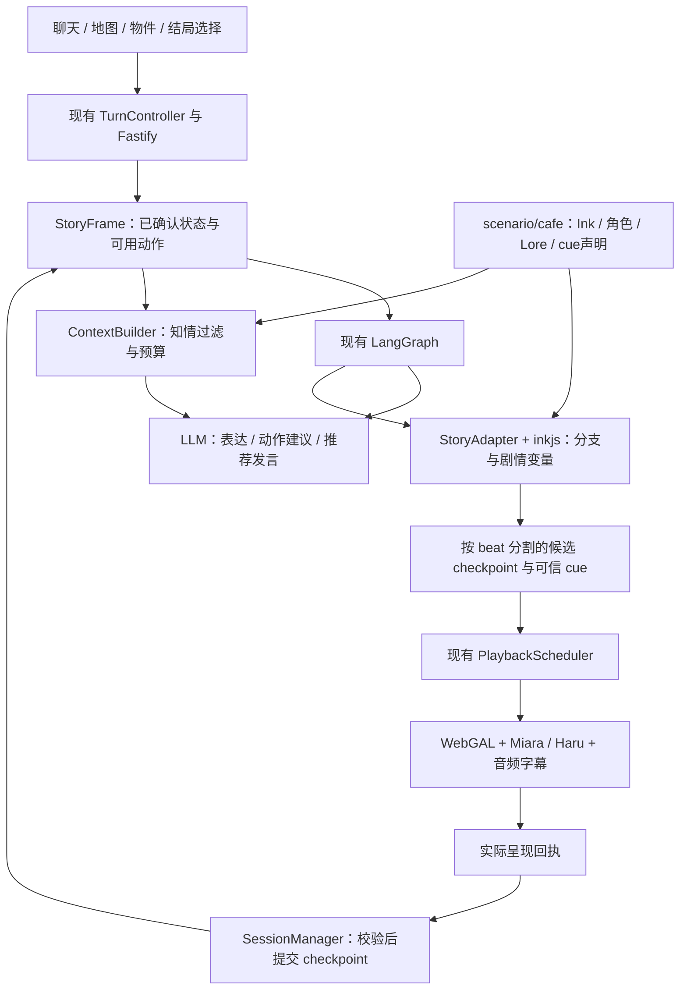

# 轻量剧情控制设计：Ink、上下文与 WebGAL

日期：2026-10-31（Asia/Shanghai）。版本：**v0.3，Ink已接入**。本稿保留设计依据；当前实现与本轮检查/调试结果以[Ink接入记录](../acceptance/narrative-ink.md)为准。SQLite、更多故事包等后续项仍为设计。

依据：已读取引用聊天「Review Miara and WebGAL plan」中的实际用户要求与场景修订，并核对[八场景设计](../miara-webgal-scenario-design.md)、[当前实施记录](../acceptance/miara-webgal-story.md)、scenario、Graph、SessionManager及React/WebGAL宿主。该聊天仍在推进实现，本文指出的是读取时的代码边界，不把其他聊天的历史结果当作本轮验证。

## 1. 推荐结论与范围

建议采用：**服务端 inkjs 运行剧情，现有 LangGraph 编排 LLM/STT/TTS，现有 WebGAL 执行演出；复用 `apps/server/src/scenario/` 作为剧情业务的聚合目录，用故事包组织角色、世界信息和演出映射。**

SillyTavern借鉴角色档案、Lorebook、Author's Note和分层记忆的组织方法。剧情分支、变量与存档交给专门的叙事运行时。故事控制和角色表达有各自清晰的权限，再通过同一轮次、播放与回执链连接。

故事规则仍需要创作。目标是让新增一个线索、改变一个结局条件、补一次回访时，主要修改故事内容文件，而不用继续修改HTTP、SessionManager或添加一串TypeScript分支。必须自写的部分收敛为：项目现有协议的适配、呈现确认和上下文过滤。这些不是Ink或SillyTavern已经替项目解决的功能。

MVP先保留一个成年角色身份、一个故事包、八个地点、三种结局、现有单进程会话。不增加通用插件市场、可执行脚本上传、可视化编辑平台、数据库集群或第二套Agent后端。

## 2. 目前为什么会有“场景通了，剧情不自然”的感觉

| 读取到的实现                                              | 对体验的影响                                             | 本提案对应变化                                 |
| --------------------------------------------------------- | -------------------------------------------------------- | ---------------------------------------------- |
| `scenario/story.ts` 用正则识别移动、读信和结局            | 说法覆盖依赖补规则，问题、假设、否定与行动容易混淆       | 按当前可用动作解释语义，按钮直接使用动作ID     |
| `resolveStory()` 同时放路线、道具说明、回访文案和结局事件 | 新剧情需要改服务代码；内容与基础逻辑耦合                 | 分支与回访进入Ink，素材/说明进入场景包         |
| StoryState主要是location/revealed/ambience/ending         | 位置明确，但没有“已相遇、愿意谈选择、进入尾声”等叙事进度 | 用剧情里程碑与显式选择组织三幕                 |
| 当前结局入口主要校验地点与既有ending                      | 到达某位置与角色已经愿意共同作决定容易混为一谈           | 相遇、转折或尊重边界的陪伴均有实际节点         |
| 信件/回信文本同时存在后端`PROP_TEXT`与前端场景定义        | 后续修改容易形成画面、上下文不同版本                     | 正文单一来源，前端显示与模型知识引用同一内容ID |
| 聊天与确定性场景操作在Graph中分支执行                     | 确定性操作没有错，但需要共同的叙事目标约束               | 两类输入都读取同一StoryFrame和已确认checkpoint |

已有的generation、输入幂等、取消、事件依赖、独立呈现回执都是可复用的基础。重构应替换剧情策略，保留已经打通的聊天和播放链路。

## 3. 中间件取舍

| 方案                | 已有能力与适配性                                                                                            | 建议                                                                           |
| ------------------- | ----------------------------------------------------------------------------------------------------------- | ------------------------------------------------------------------------------ |
| **Ink + inkjs**     | 为互动叙事设计；分支选择、变量、条件文本、回访计数、tags、序列化状态；Node/TypeScript可用；Inky可供创作预览 | **首选**，适合已有八地点、固定真相、三幕三结局                                 |
| **XState**          | 层级/并行状态、guards、actors和持久化；适合通用业务状态与流程控制                                           | 备选；若团队更愿意维护状态图且文案较少可选。当前不与Ink同时引入                |
| **已有LangGraph**   | 异步模型流程、结构校验、受限修复和取消传播                                                                  | 继续使用；不把每个房间与每句台词都展开为Graph节点                              |
| **SillyTavern整体** | 丰富的角色、世界信息、提示组织与交互工具                                                                    | 借鉴内容组织，不作为本项目的运行后端；World Info本身不是呈现确认或剧情事务引擎 |

2026-10-31读取npm官方registry：inkjs **2.4.0 / MIT**、XState **5.33.3 / MIT**。inkjs README声明零依赖且支持Node和浏览器；registry未列runtime dependencies。已读取Ink/inkjs官方README、运行文档和源码中的`currentChoices`、`currentTags`、`ChooseChoiceIndex`、`state.ToJson/LoadJson`及Compiler接口。

这些是选型依据，不是兼容性实测。实施时锁定编译器、runtime、故事格式及存档版本；先在项目Node 26.13.0/ESM中验证。可以在构建期使用`inkjs/full`的Compiler，服务端运行期使用`inkjs`；不因采用Ink而要求生产容器新增.NET。Ink与Inky版本编号不相同，不能混用不匹配的编译产物。

## 4. 推荐架构与职责



- **Ink**：决定当前叙事节点、可用选择、分支、回访差异和已确认剧情变量。
- **LLM**：在已知内容和当前目标内组织自然表达；把自由语言解释为当前候选动作或澄清；生成用户可编辑的推荐发言。
- **LangGraph**：控制本轮调用顺序、响应校验、修复、TTS与故障；所有LLM调用仍在Graph内。
- **SessionManager**：保管当前已确认checkpoint、轮次身份、历史和回执；不会因Ink已经计算完就提前提交。
- **WebGAL与Scheduler**：执行画面/声音与资源生命周期，报告实际结果；不创建第二份叙事真相。

Ink不管理麦克风、fetch或音频；WebGAL原生脚本不再独立推进主剧情。tags只映射项目白名单cue和资源ID，不开放任意WebGAL命令、JS、路径或URL。

## 5. 从SillyTavern借鉴什么

| SillyTavern概念             | 本项目的小型对应物                                               | MVP边界                                                         |
| --------------------------- | ---------------------------------------------------------------- | --------------------------------------------------------------- |
| Character Definition / Card | `character.json`：身份、表达方式、关系边界、少量示例             | 一个角色档案，不做角色市场或全格式兼容                          |
| World Info / Lorebook       | `lore.json`：地点、公开背景、海报、已读信件等条目                | 先过知情门槛，再按地点/话题选择；不做递归激活、概率激活或向量库 |
| Author's Note               | 当前StoryFrame中的`directorNote`：本节点想表达什么、不能泄露什么 | 由已确认剧情节点确定，不按每N轮机械注入                         |
| Chat History / Memory       | 已确认台词与结构化剧情事实                                       | 继续按真实呈现记录；长历史按token预算裁剪                       |
| 变量与提示约束              | Ink剧情变量与服务端规则                                          | 不靠prompt自行声明“已经解锁”或修改事实                          |

World Info官方说明本来就是动态插入相关背景，它不能保证模型一定使用，也不负责证明玩家是否已经读到。这里把“相关性”和“允许知道”分开：**先判断能否进入上下文，再考虑是否与本轮相关。**

不建议一开始实现SillyTavern的完整宏、Regex扩展、脚本系统、递归Lore激活和多种插入深度。当前八场景只需要几层可解释的上下文。

## 6. 在现有scenario中按故事和场景组织

v0.2修订：取消上一版并列新增`apps/server/src/narrative/`与根`stories/last-lamp/`的目录建议。当前`scenario/`已经是Graph注入场景策略的边界，继续将它作为剧情业务聚合；本提案允许调整其内部结构与接口，不为保留旧文件名而留下重复实现。

### 6.1 推荐目录

以下结构已接入；`compiled.json`为构建时生成、Git忽略的受版本/hash约束的编译产物，具体边界见接入记录：

```text
apps/server/src/scenario/
  ports.ts                       # 演进现有ScenarioDefinition，定义frame/propose等边界
  runtime/
    ink.ts                       # 通用inkjs适配、候选checkpoint、帧投影
    context.ts                   # 通用上下文组装、知情过滤、推荐提示
  cafe/
    index.ts                     # 由现有cafe.ts演进，组合runtime与咖啡馆故事包
    manifest.json                # storyId、版本、入口、合法资源ID与cue声明
    character.json               # 从现有identity.ts迁入业务身份与表达边界
    lore.json                    # 背景、道具正文、公开条件；按地点/话题标记
    main.ink                     # 全局剧情变量、入口和INCLUDE
    scenes/
      street-wide.ink            # 街角开场和回望
      cafe-front.ink             # 门头、营业告示与门牌
      lobby.ink                  # 相遇、分流与回访
      window-seat.ink            # 等待、照片、自由陪伴的叙事锚点
      photo-corridor.ink         # 海报与共同经历
      washroom.ink               # 关于犹豫的可选谈话
      counter.ink                # 信封、读信、回信
      street-walk.ink            # 离店后的谈话与余韵
    endings.ink                  # 跨地点的三种收束，共用场景节点
```

MVP先保持两份通用runtime文件、一个cafe包和每地点一份Ink文件；某地点内容明显变长时，再拆独立lore/演出配置，不要求每个地点都先建一组空文件。`manifest.json`只做清单与可信ID声明；分支条件使用Ink，不另造JSON/YAML条件执行语言。

场景中的照片、信件、热点等仍复用现有协议和WebGAL适配。后端不接管Pixi坐标、雨窗遮罩或模型参数；这些继续留在`apps/web/src/webgal/scenes/cafe/`。业务剧情与视觉布局共享稳定地点/道具ID，在构建或配置校验时核对引用。

### 6.2 Ink范式与项目中的“场景”

Ink[官方创作指南](https://github.com/inkle/ink/blob/master/Documentation/WritingWithInk.md#6-includes-and-stitches)明确举例：可以用**knot表示场景、stitch表示该场景内事件**；`INCLUDE`支持把内容拆到多个文件。适合把counter中的“看见信封、决定是否打开、读后反应、回访”组织在同一个场景文件里。

但Ink不会自动根据目录创建游戏场景，也不会替WebGAL管理背景、热区或资源生命周期。文件组织由项目约定，`main.ink`显式包含场景文件，可信tag把叙事输出映射到既有cue。

```text
counter.ink
  counter.envelope_seen
  counter.ask_to_read
  counter.letter_presented
  counter.after_reading
  counter.revisit
```

这里只表达命名结构，不是已经编译验证的Ink源码。章节/里程碑可以跨越多个地点；一个地点也能在不同阶段反复出现。自由聊天不需要为每一句话建立stitch，更不必每聊一轮就调用Continue推进。

### 6.3 当前文件怎样复用和迁移

| 当前文件/职责                                    | 建议归属                       | 调整方式                                                                                |
| ------------------------------------------------ | ------------------------------ | --------------------------------------------------------------------------------------- |
| `scenario/ports.ts`                              | 原位保留并演进                 | 继续作为Graph与场景业务的接口，逐步把unknown上下文明确为StoryFrame                      |
| `scenario/cafe.ts`                               | `scenario/cafe/index.ts`       | 继续承担组合入口，装配咖啡馆包与通用Ink适配；切换完成后移除旧入口                       |
| `scenario/story.ts`中的剧情分支/台词/回访        | cafe的Ink文件与lore            | 迁移内容规则，删掉被替代的TS分支；通用导航算法有实际需要时再保留为小工具                |
| `scenario/identity.ts`                           | `cafe/character.json`          | 保留现有身份字段，区分业务角色与Miara/Haru渲染模型                                      |
| `scenario/prompt.ts`                             | `runtime/context.ts`加cafe内容 | 通用输出约束留在代码，咖啡馆身份/阶段提示由内容包提供                                   |
| `scenario/rules.ts`中的特定剧情条件              | cafe的Ink条件                  | 如照片许可、读信前后、结局门槛；网络schema、资源白名单仍由现有公共边界校验              |
| SessionManager中的回执、冻结、revision           | 现有`sessions/manager.ts`      | 保留所有权；通过scenario接口取得或提交候选checkpoint，不新增并行presentation-commit服务 |
| `providers/openai/planner.ts`直接导入Mira prompt | 由Graph传入场景上下文/提示     | Provider保持供应商适配职责，避免模型适配器继续知道咖啡馆剧情                            |
| 前端cafe定义中的道具正文                         | 后端cafe Lore作为单一来源      | 合法展示时随既有呈现协议提供正文；前端仍负责显示与布局                                  |

目录复用也包括接口职责重整，而不只是移动文件。`ScenarioDefinition`可以从当前的`intent/context/validate/resolve`演进为`frame/propose/accept`等少量操作：读已确认状态并导出当前框架、计算候选故事beat、根据已校验呈现结果返回下一checkpoint。Graph负责调用，SessionManager负责保管与原子提交，scenario不读取HTTP请求或直接操作会话Map。语言意图的解释进入既有planner，不再以一份场景正则作为主入口。迁移期间可以短暂兼容旧接口，切换后清除旧分支，避免两套故事并存。

编译产物路径在实施时接入现有server构建与Docker复制流程，单独于会话存档管理；不会放进前端public暴露整部剧情，也不会作为新根目录平行维护第二份故事。

场景源码、编译结果和完整Lore在服务端；前端仅收到公开资源表、当前可用动作和已授权显示的道具正文。当前固定地点枚举可以先复用；真正支持第二个故事时，再把故事专属ID从全局枚举迁到manifest校验，不提前建设注册平台。

一个Lore条目的设计示意：

```json
{
  "id": "letter.invitation",
  "requiresPresented": ["letter.read"],
  "locations": ["counter", "window-seat"],
  "topics": ["阿岚", "邀请", "展览"],
  "content": "阿岚下午来过，并邀请米拉把新照片带去下一站的展览。"
}
```

`requiresPresented`只支持“这些已确认事实全部成立”，不支持自定义代码、运算符或脚本；复杂叙事条件留在Ink。关键词只筛选已经过权限门槛的条目，即使用户直接输入“阿岚下午来过”，也不能激活未读信的隐藏事实。

对玩家说过但未证实的内容，标为用户陈述，不合并到世界事实。

## 7. 状态与提交：保留当前最有价值的不变量

### 7.1 只有一份已确认剧情状态

```text
CommittedCheckpoint
  storyId / storyVersion / artifactHash / inkRuntimeVersion
  revision
  inkStateJson

StoryFrame（从checkpoint导出的只读投影）
  phase / location / ambience
  presentedFacts / playerKnowledge / characterKnowledge
  activeBeat / directorNote
  availableActions / activeLoreIds
  suggestionContext（已知边界、可选机会，不是强制任务）

TurnProposal（仅当前有效轮次）
  baseRevision / turn identity
  beats[]：cue、呈现前置、候选checkpoint
```

SessionManager仍是保管者；Ink存档是剧情状态的运行表示。现有`StoryState`、UI地点和known事实逐步改为checkpoint的投影，不与Ink变量分别更新成两套权威。已完成用户/助手文本仍由现有history保管。

地点与章节是两个维度：可以在第二幕回窗边，不能因为切到第一张背景就重置第一幕。渲染选择`miara/haru`是表现偏好，不改故事身份或人物关系。

`playerKnowledge`和`characterKnowledge`不能简单画等号。米拉知道自己与阿岚的过去，玩家未必知道；阿岚留下的邀请则必须在实际读信后，才成为本场交流可引用的新信息。MVP可以用明确的内容分组与暴露里程碑表达，无需通用人物知识图谱。

### 7.2 Ink计算完成不等于剧情成立

1. 从revision为R的已确认存档创建本轮独立runtime/副本。
2. 解释一个合法动作，得到若干作者定义的**beat**（最小叙事呈现单元）。
3. 每个beat附可信cue、必要语音/视觉回执和候选checkpoint。计算过程中不覆盖已确认存档。
4. 复用现有Scheduler执行；SessionManager校验真实目标、依赖、顺序与轮次。
5. 只提交**成功呈现的连续前缀**。后面的成功回执不能越过失败或取消的前置。
6. 新输入冻结旧轮，保留已提交前缀，丢弃剩余候选。下一轮从最后确认的checkpoint构造菜单与上下文。

例如“留回信后离店”应拆成：回信入托盘 → 到门头 → 翻牌/收灯 → 街道就绪 → 雨势变化 → 结局确认。若只完成到门头，就保留回信和门头位置，不能宣布已经到街道或完整结束。

**不能把整段Ink跑到结尾再只存一个最终JSON。** 这会在中途打断时丢掉已发生的地点/道具变化，或者把未呈现的部分提前记住。也不能直接在Ink变量观察回调里写Session，因为runtime推演和lookahead不代表实际呈现。

适配器的关键工程约束：作者定义的beat必须结束在可恢复的输出/选择/等待边界；状态修改与该beat的呈现目标一一对应。中断后能够从已确认前缀导出合法菜单，**不自动续播旧离店计划**。需要时通过可信内部恢复入口回到菜单；Ink路径由后端故事包控制，LLM和浏览器不提供路径。

这部分是项目需要验证的薄适配，并非Ink现成的“媒体事务”能力。先用小切片验证checkpoint边界、内部选择恢复及部分提交，验证不了就暂不迁移三种结局。

### 7.3 刚接受的意图与呈现事实分开

用户明确选择离店，可以立即记录“请求离店”；只有街道、灯光等效果完成，才记录“离店已完成”。请求本身不能当成世界结果。

带revision的动作ID绑定当时的可用菜单。旧页面点击、重复提交或故事更新后出现的旧ID需拒绝或刷新。取消后合法旧回执只补确认冻结范围内的前缀，不能恢复旧任务或把新地点倒退。

首版保留单实例内存。需要跨重启恢复时，再把**已确认checkpoint + history**持久化到SQLite；不恢复正在运行的Provider调用或未呈现队列。旧会话固定故事版本，新故事默认用于新会话，不直接把旧Ink存档加载到新编译产物。

checkpoint提交要比较父revision，并把回执去重标记与新revision一起原子写入。下一轮begin先合并冻结快照，再取得它的baseRevision。已经确认的旧回执重发只做幂等确认；不能在新分支推进后直接加载旧轮的整份Ink JSON。对不在冻结范围内的迟到成功结果继续拒绝，避免旧存档倒退新地点；发生冲突时返回当前快照重新取菜单。

## 8. 自由聊天与剧情动作如何结合

### 8.1 点击操作

地图、热区和关键结局按钮发送当前StoryFrame中的opaque actionId与revision。服务端查找其对应Ink选择，验证仍可用后提议演出。客户端不发送任意Ink knot、脚本或变量变更。

纯导航、重看已公开材料可以保持确定性、无需LLM。关键剧情节点有作者定义的必要信息和台词；自由表达不能改写信件或提前宣布结果。

### 8.2 聊天操作

保留一次正常LLM调用，同时解释当前输入、生成聊天回复和推荐。结构化结果在概念上分三类：

```text
chat：正常ReplyPlan + 用户下一句推荐
act：当前允许的actionId（不自行生成执行代码或既成结果台词）
clarify：自然澄清 + 可选的当前动作建议
```

普通聊天使用LLM的台词；`act`使用Ink产生的可信叙事beat与必要台词，并可保留同次生成、经过合法性过滤的闲聊候选，不再串联第二次LLM去补写一轮。这样不要求“先分类模型，再回复模型，再推荐模型”。保留现有最多一次结构修复，不能保证每轮永远只有一次请求。

需要一条更富表现的动态剧情台词时，可以以后增加明确的润色节点；它是额外成本和等待，应单独评估，不作为MVP默认步骤。关键揭示优先保证正确、可控和可中断。

语义解释只从本轮`allowedActions`选择。比如：

| 用户输入                        | 行为                         |
| ------------------------------- | ---------------------------- |
| “去吧台看看”                    | 选择当前合法导航动作         |
| “如果我去吧台，会发生什么？”    | 讨论/澄清，不移动            |
| “别打开那封信”                  | 不读信，可承接尊重边界的谈话 |
| “我也在等一个人”                | 普通聊天，不自动触发结局     |
| “我们走吧”但尚未相遇/意图不明确 | 澄清，不能直接到街道结局     |

自然语言判断不是物理权限。读信、留下回信、三结局等关键动作可标记`requiresExplicitChoice`：模型先建议合法按钮，由用户点选执行；地图热区本身已是明确选择，无需再次弹确认。普通清楚的导航可直接推进。模糊、假设、否定不执行。

推荐语句仍是用户草稿，不写事实。采用下文的软联动：候选不预绑定可执行动作，发送后按当前上下文重新解释；真正的地图/物件/结局按钮才提交动作ID。

### 8.3 推荐需要软联动，而不是照搬Ink选项

**需要联动的是事实边界、行动合法性与当前交流机会；不要求每条候选都是推进剧情的选择。** Ink的currentChoices是当前可用剧情动作的一部分，LLM推荐则是用户可以怎么接话，两者不是同一个列表。

如果把Ink的每个选择都逐项改写为推荐，体验容易变成“下一步去哪/再查什么/选择结局”的任务导航。相反，完全不提供剧情上下文也可能出现剧透、失效行动或刚拒绝就再次追问。建议把“当前能做什么”与“值得怎样接话”分别建模。

| 候选类型      | 生成依据                                             | 与Ink的关系                                              |
| ------------- | ---------------------------------------------------- | -------------------------------------------------------- |
| 自然接话/闲聊 | 刚才实际呈现的回复、用户话题、个人表达与已知人物背景 | 可以没有对应Ink选择，默认不推进剧情                      |
| 可选探索      | 当前环境里已可见的物件、当前合法动作                 | 有机会才推荐，允许完全不出现；不把未解锁信息写进草稿     |
| 关键决定      | 角色已经愿意谈决定、用户表现出相应意愿               | 只在合适节点出现，仍需明确选择；不把三结局常驻成每轮推荐 |

推荐策略用一小段公共提示与故事包内容组织，MVP不做排序模型或目标评分系统：

- 默认尝试给2条自然、不同方向的接话；必要时可少给或为空，最多3条。
- 不要求每轮固定“1条闲聊+1条推进”；同一轮可以全部是闲聊，也可以没有行动候选。
- 探索/主线候选最多1条，且必须自然承接本轮对话；可用动作不等于必须推送。
- 用户主动说自己的事情、明确不追问或想安静坐会儿时，优先跟随用户，不借回复反复拉回信件。
- 记住用户明确的暂不讨论话题；只有用户重新开启才恢复相应建议。偏好来自用户已确认输入，与世界事实分开，不伪装成好感度或任务完成度。
- 允许长时间闲聊而Ink revision不变；有来回回应本身就是有效体验，不以推进节点数评判成功。
- 不给“推荐/正确路线”视觉等级，不把行动候选高亮成默认最优，也不因用户忽略候选而倒计时或惩罚。

例子，信件尚未公开时：

| 当前交流                         | 合适的候选示例                                                  | 不应出现的引导               |
| -------------------------------- | --------------------------------------------------------------- | ---------------------------- |
| 她说“我在等一位很久没见的朋友”   | “你们是怎么认识的？” / “我也有一位很久没见的朋友。”             | “去吧台找她留下的邀请信”     |
| 用户说“先不问那些，聊聊旅行吧”   | “哪次旅行最让你舍不得离开？” / “我想讲讲我去过的地方。”         | 再次追问她为什么不读信       |
| 到吧台后，她说“这个字迹，我认得” | “不急，你可以慢慢决定。” / 可选：“如果你愿意，我陪你一起看看。” | 默认打开信、默认知道下午来过 |
| 已读信，用户还想继续坐着聊       | “你现在是什么感受？” / “我们可以再坐一会儿。”                   | 因为进入第三幕就强制推荐离店 |

这些是设计示例，不作为硬编码候选表。Live仍由同次LLM根据最新上下文生成；Mock提供相应模拟数据。

### 8.4 生成、展示与发送的联动边界

```text
已确认StoryFrame + 近期对话/用户偏好 + 本次角色回复
                  ↓ 同次planner
        ReplyPlan + suggestions
                  ↓ 结构/引用校验
     当前轮实际呈现完成后，按最新Frame过滤
                  ↓
       用户点击 → 填草稿 → 编辑 → 确认发送
                  ↓
    以当前Frame重新解释聊天或动作，不复用旧动作绑定
```

- 保留现有“一次正常LLM同时生成回复和推荐”的流程，不另加推荐接口、分类模型或推荐模型；现有受限修复仍可发生。
- 现有公开`{label,draft}`结构可以继续使用。后端若需要验证或筛选，内部可增加`kind`与可选`relatedActionId`，用于关联和审计，**不作为点击推荐即执行的指令**。
- 任何relatedActionId必须来自本次Frame的合法集合；普通闲聊可以没有ID。推荐生成不能解锁新选择，也不能直接写Ink变量。
- 推荐关联生成时的revision。展示前按当前已确认Frame复核动作引用；失效候选删除即可，不为了凑满数量再次调用LLM。被打断或呈现失败的回复继续按现有Scheduler边界抑制推荐。
- 用户编辑、语音转录后编辑，都以最终确认的文字为准。合法动作集在真正执行时再次校验，旧推荐不能绕过新的状态门槛。

结构、已公开内容集合和动作ID可以确定性校验；schema不能证明自由语言百分百没有暗示或编造。因此不能承诺推荐文本绝对不偏移。通过最小知情上下文、明确生成规则、失效候选过滤及针对性的验收控制风险；明显无效候选允许不展示，避免用新一层模型循环补救。

这里的“框架”约束世界真相、人物一致性与可执行行为；话题可以超出当前主线。讨论天气、咖啡或玩家自己的经历，只要不改写既定事实，都属于允许的自由聊天。

## 9. 结合八场景，剧情如何变得有因果

三幕由**已确认的里程碑**组织，而不是场景编号、点击次数或隐藏好感值。

| 叙事阶段   | 解锁依据                                     | 场景中的表现                                           |
| ---------- | -------------------------------------------- | ------------------------------------------------------ |
| 到来与相遇 | 进入店内、首次相遇实际呈现                   | 门头到大堂、米拉邀请坐下；不会在门口就当成已聊很久     |
| 理解与探索 | 听到等候缘由，或选择尊重边界的陪伴           | 窗边、海报、洗手区、吧台提供不同交流入口               |
| 愿意作决定 | 已读信并听到她的反应，或完成不读信的陪伴节点 | 角色可以表达“愿意想想接下来去哪”，再出现合适的收束选择 |
| 收束与余韵 | 用户明确选路，相关演出实际完成               | 街道、门前告别、窗边一盏灯分别保留实际结果             |

八张背景是空间；同一空间可承载多个beat。候选节点例如：

- `lobby.first-meeting`：遇见，不透露信的答案。
- `window.waiting`：解释等待与空椅。
- `corridor.shared-past`：海报使共同经历进入可聊内容。
- `washroom.first-sentence`：谈重新联系的犹豫，是可选情绪入口，不是搜集钥匙。
- `counter.envelope-seen`：只有署名，仍不知道正文。
- `counter.letter-presented`：正文实际可见后进入已知内容。
- `window.boundary-respected`：玩家不追问，她回应接受陪伴；不读信也能走向决定。
- `decision.depart / leave-note / stay`：明确选择不同的行动收束。

先看海报再读信、先读信再回走廊，由Ink条件文本与访问/呈现标记区别；全局真相不变。进入房间或Ink内部visit计数不能等同于读到信；“看见信封”和“看过正文”分成两个事实。

结局可以有门槛，但玩家随时可以结束会话或独自离开；这不自动等于“米拉愿意与你同行”的A结局。三种结局没有优劣评分，陪伴路线也不需要把所有道具点完。

## 10. 上下文组织：小型Lorebook与当前导演提示

每次只组装：

1. 固定角色身份、回复格式和权限边界。
2. 当前已确认phase/location/beat，以及必要的世界事实。
3. 当前地点与已知线索中和本轮有关的Lore。
4. 当前`directorNote`：例如“她认出笔迹但还没读信；可以犹豫，不能提及展览邀请；若用户转聊别的，跟随其话题，无需推动读信”。
5. 当前允许的动作与关键动作的选择要求。
6. 有预算的近期已确认对话、用户明确偏好与本次输入。

导演提示描述当前情绪、可选机会与事实边界，默认不下达“本轮必须推进”“必须让用户发现信”等任务。真正必要的剧情门槛在Ink控制，LLM不承担赶进度的职责。

完整信件真相只保留在故事包里；未解锁时不把隐藏全文发给模型再要求它“不要剧透”。公开条目的相关性可以用简单关键词或场景ID，复杂规则用Ink，不把一套大Lore引擎搬进来。

输入预算由配置决定，不假定用户GPT模型的context window。固定规则和必需事实先占预算，历史优先裁旧；项目已有`@langchain/core`提供`trimMessages`可复用。实施时选择明确的token计数策略，不为了计数额外请求模型。

MVP先不加自动LLM摘要。结构化里程碑不会随40条历史滚动消失；若长会话确需摘要，再以已确认内容生成、标注来源和revision，摘要不能创造新事实或成为独立权威。

## 11. 增量落地方式

| 阶段          | 交付                                                                                                    | 门禁                                                               |
| ------------- | ------------------------------------------------------------------------------------------------------- | ------------------------------------------------------------------ |
| P1 小切片     | 固定inkjs候选版本；窗边/走廊/吧台；相遇、海报、读信、拒绝；在现有scenario目录内接ScenarioDefinition端口 | Node/ESM编译加载、tags校验、存档往返；先证明按beat提交和取消恢复   |
| P2 上下文统一 | character/Lore/directorNote、道具正文单一来源、知情过滤；按钮提供真实可用动作                           | 未读信不泄露，先后探索与重复查看有区别；不改变语音预览和播放所有权 |
| P3 聊天融合   | LangGraph同次chat/act/clarify与软联动推荐；移除主路径正则触发                                           | 假设/否定/模糊表达不误动作，关键选择尊重用户，旧revision拒绝       |
| P4 内容扩展   | 其余五地点、三幕和三个完整结局；旧规则迁出服务代码                                                      | 中断保留连续前缀，不读信也有完整路线，结尾后有对应余韵             |
| 后续按需      | SQLite确认存档、创作工具、更多故事包、可选摘要                                                          | 不复活旧音频、不混用版本；没有需要时不提前建设                     |

初版只新增inkjs这一项剧情运行依赖，已有Zod、LangGraph、播放与WebGAL均复用。场景包只接受可信本地内容；编译期拒绝未知tag/资源、外部绑定和不支持的版本，限制每次展开数量及输出体积。无输出死循环必须在创作验证中排除；将来开放不受信任故事上传时，需另做可终止的执行隔离，不能声称普通AbortSignal能中断同步解释器。

## 12. 后续实施验收清单（本轮未执行）

- 同一存档在两次加载后得到一致的合法选择；版本不匹配明确拒绝。
- 相同动作与幂等键不重复推进；旧actionId/revision不能套用当前状态。
- 信封可见、正文失败：不解锁邀请；正文成功后才能在下一次上下文引用。
- 选择离店后只走到门头就打断：保留门头/已留回信，未呈现的雨势和结局不提交、不自动续播。
- 两个地点的迟到/乱序回执不会覆盖更新checkpoint。
- 干预Ink计算、LLM或TTS取消后，副本和候选状态不污染已确认故事。
- 玩家说“如果离开会怎样”“别读信”时不执行关键动作；点选真实可用按钮才能推进。
- 先海报后信、先信后海报、拒绝照片、不读信陪伴分别有可见反馈。
- 连续闲聊不会按轮数自动开信、刷关系值或强制结局。
- 不同角色渲染模型切换只影响表现，不重置剧情；WebGAL不独立执行第二份故事。
- 场景包的同一道具正文在画面和模型已知信息中保持一致。
- 确认过的语音草稿仍只发送最终编辑文字；推荐不自动触发动作。
- 普通闲聊候选可以没有Ink动作；用户不聊信、长时间闲聊时不自动推主线。
- 当前无可执行探索机会时仍能自然接话，不为填满候选而推荐非法或剧透行动。
- 选择建议后修改为否定/假设/其他话题，不会执行原候选关联的动作。

实施时遵守AGENTS：未经用户明确要求不运行功能、运行时或E2E测试；允许的静态、编译、格式和契约检查单独执行。不能把本设计的验收条目写成已有通过结果。

## 13. 实际查阅的来源与边界

- [SillyTavern Character Design](https://docs.sillytavern.app/usage/core-concepts/characterdesign/)：角色定义、场景、首条消息与示例对话的组织。
- [SillyTavern World Info](https://docs.sillytavern.app/usage/core-concepts/worldinfo/)：关键词激活、相关背景、预算与其不保证生成内容的边界。
- [SillyTavern Author's Note](https://docs.sillytavern.app/usage/core-concepts/authors-note/)：可按位置/频率加入的叙事提示；本方案只保留当前节点提示这一小部分。
- [Ink官方README](https://github.com/inkle/ink)、[Writing with Ink](https://github.com/inkle/ink/blob/master/Documentation/WritingWithInk.md)、[Running Your Ink](https://github.com/inkle/ink/blob/master/Documentation/RunningYourInk.md)：分支、条件、tags、状态保存/恢复与嵌入式引擎边界。
- [inkjs README与兼容表](https://github.com/y-lohse/inkjs)、[npm inkjs 2.4.0](https://www.npmjs.com/package/inkjs/v/2.4.0)：Node/JS运行、Compiler、ESM导出与版本候选；MIT许可。
- [XState guards](https://stately.ai/docs/guards)、[Persistence](https://stately.ai/docs/persistence)、[npm XState 5.33.3](https://www.npmjs.com/package/xstate/v/5.33.3)：备选状态机能力与候选版本；未做项目集成。网站可能展示新的文档版本，实施时须匹配锁定的稳定版。

v0.2补充：目录复用现有scenario；推荐采用事实/行动硬边界与话题软引导，移除上一版独立narrative和根stories目录建议。

当前已安装固定inkjs并接入Ink故事，XState未引入。设计阶段的资料核验与本轮实现后的静态检查/实际页面调试是不同证据，详见[接入记录](../acceptance/narrative-ink.md)。
