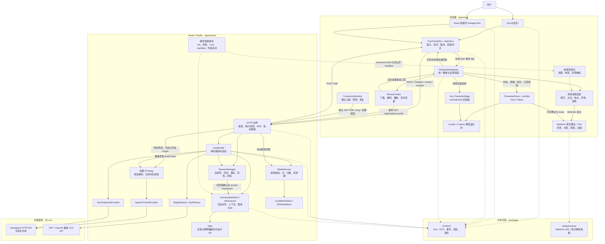
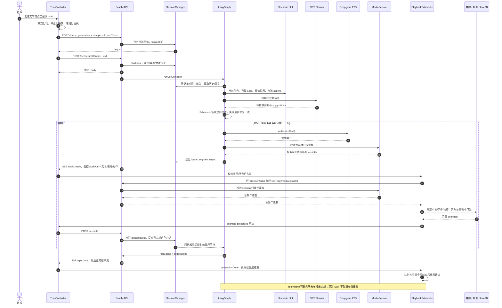
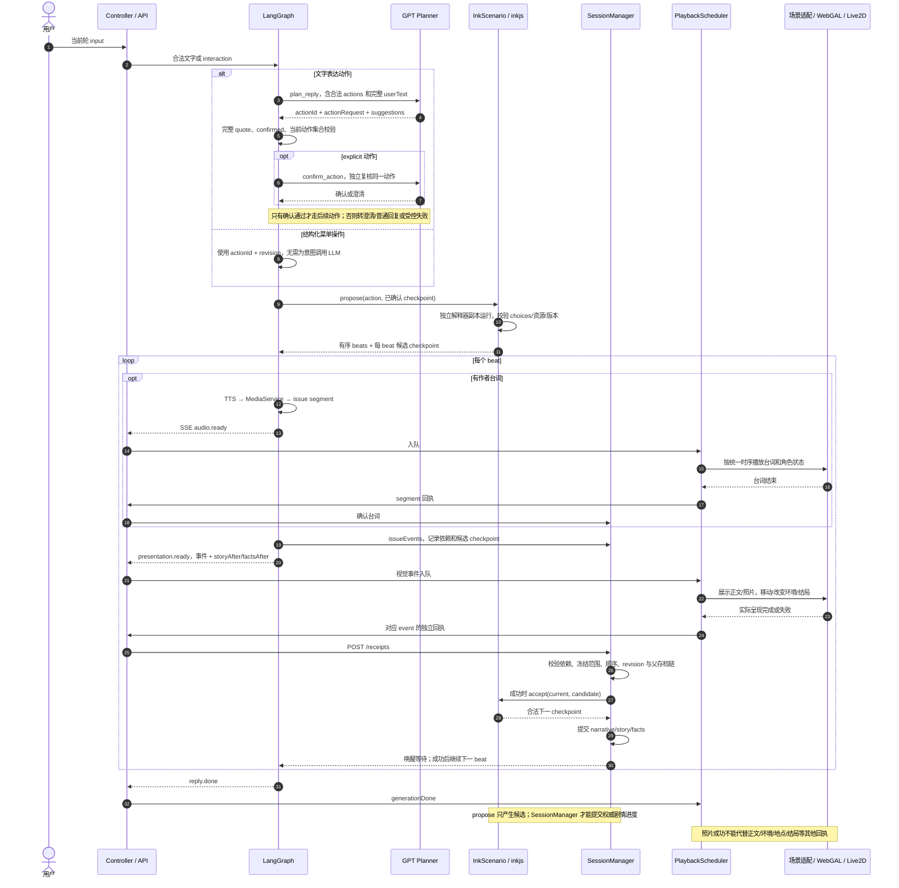
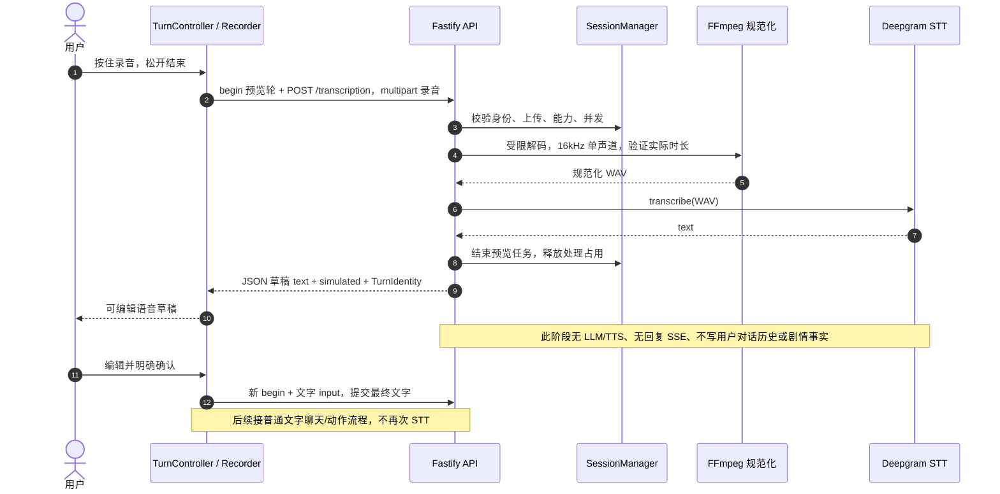
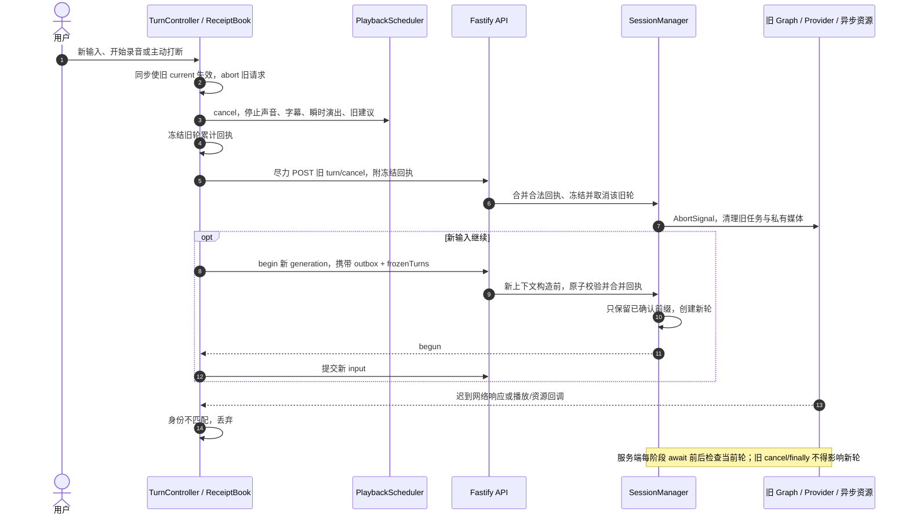
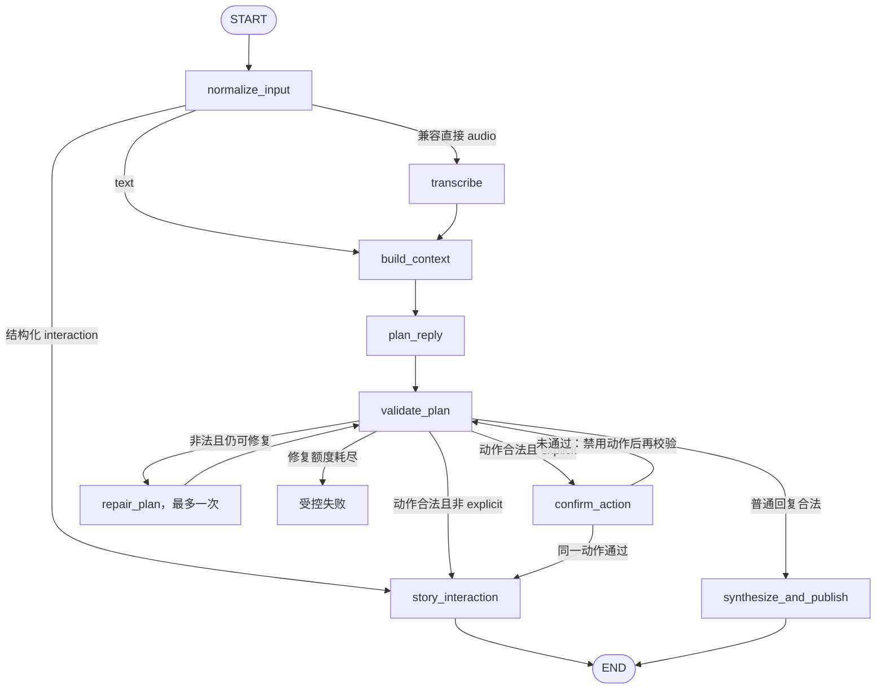

# 角色互动平台：当前组件、职责与交互时序

2026-11-01，按当前工作区源码梳理。本文描述已写入代码的交互，不以历史设计稿代替现状；未启动服务、执行功能/运行时/E2E 测试或调用真实供应商。标准 UML 源文件见 [program-interactions.puml](program-interactions.puml)；本页用 Mermaid 展示相同的主要关系。

## 1. 先看整体

程序有两套浏览器宿主，共享一个独立 Node/Fastify 后端：

- `/legacy.html`：Vue 原版对话页，`entry=conversation`，通过原版 Live2D 渲染器展示 Haru。
- `/`（默认）与 `/webgal.html`：React + WebGAL 故事页，`entry=story`，默认 Haru，Miara 可显式选择。`?preview` 是本地引擎工作台，不是另一套后端故事系统。
- 两套宿主复用 `TurnController`、`PlaybackScheduler`、API、SSE 和回执协议，但拥有各自的页面状态与渲染适配。
- Live：Deepgram STT → GPT 兼容接口规划 → Deepgram TTS。Mock：替换这三个 Provider；后端会话、Graph、HTTP、媒体、播放和回执链路继续复用。

**五个关键角色：Ink 决定合法剧情；LLM 理解输入并生成内容；LangGraph 编排一轮处理；PlaybackScheduler 控制浏览器播放呈现；SessionManager 提交确认后的事实。**

## 2. 组件交互图

实线表示调用或数据流，虚线表示代码依赖或构建产物关系。图中的 Provider 是能力接口，Live 和 Mock 是可替换的实现。

注意：`packages/protocol` 是双方导入的代码包，不是网络中转服务；实际网络连接是浏览器与 Fastify 之间的 HTTP/SSE。共享包的准确拼写是 `protocol`，不是 `protocal`。

## 3. 边界与职责

| 组件                                     | 负责什么                                                                              | 边界                                                                                                |
| ---------------------------------------- | ------------------------------------------------------------------------------------- | --------------------------------------------------------------------------------------------------- |
| Vue / React 产品 UI                      | 输入、录音草稿、近期对话、菜单、建议、错误；展示状态投影                              | 不保管权威剧情，不自行调用模型或提交 Ink 状态                                                       |
| TurnController                           | 创建/恢复会话、begin/input、校验事件身份和连续序号、打断、草稿确认、回执同步          | 不决定剧情；正常流结束后不停止仍有效的队列                                                          |
| PlaybackScheduler                        | 排队、音频与字幕、动作/口型状态、视觉呈现调用、完成/失败回执、建议发布                | 是交互回应的唯一播放调度入口；不把 `reply.done` 当成已播放                                          |
| BrowserAudio                             | 经 API 下载音频、解码、播放/停止、实际音量采样和结束回调                              | 不调用 TTS，不决定模型台词和故事进度                                                                |
| 前端场景包                               | 本地资源绑定、地点布局、前景、环境预设、照片/正文/转场呈现                            | 不复制服务端私有 Lore 和剧情条件；资源地址由可信配置映射                                            |
| WebGAL / Pixi                            | 原生舞台、资源生命周期、容器、背景、特效、动画与渲染                                  | 当前宿主为 `interactive`；原生剧本推进、自动播放、快进等入口受模式门禁限制，避免第二套故事/播放时钟 |
| Live2D / Cubism                          | 将状态、情绪、动作和口型映射为模型参数与画面                                          | 不理解语言，不生成声音，不确认剧情事实；WebGAL 页与 Vue 页使用不同适配器                            |
| `webgal-parser`                          | 固定版本的 WebGAL 脚本与样式解析依赖                                                  | 与 inkjs 不同；不执行服务端 Ink，也不是当前交互故事的权威路由                                       |
| `packages/protocol`                      | 严格 Zod schema、类型、轮次身份、请求/事件/回执 DTO；提供 OpenAPI 生成依据            | 不导入前后端；只定义平台能力与有界 ID，具体故事成员由活动故事包再次校验                             |
| Fastify HTTP 层                          | Bearer 鉴权、限额、JSON/multipart 校验、SSE、转录预览、私有媒体访问                   | 不把 Provider 密钥或存储凭证交给前端                                                                |
| SessionManager                           | 会话内存、单有效轮、generation、幂等、超时、已确认历史/事实、冻结回执、Ink checkpoint | 跨轮状态所有者；唯一负责把候选 checkpoint 提交成权威进度的模块                                      |
| LangGraph                                | 单轮输入分流、上下文、规划、结构/动作校验、确认复核、修复、TTS、事件发布与背压等待    | 不负责浏览器演出；当前没有 MemorySaver/数据库式长期记忆，跨轮状态由 SessionManager 持有             |
| ScenarioDefinition / InkScenario / inkjs | 当前合法 choices、阶段、已知内容、导演提示、候选 beat/checkpoint；校验存档父链        | `propose` 在副本中计算，不直接改权威进度；Ink 不调用 LLM，也不渲染页面                              |
| 服务端故事包                             | `.ink`、manifest、角色身份、Lore、作者台词、资源成员、Mock 内容                       | 隐藏信息与剧情条件留在后端；前端仅得到公开投影及当次授权展示正文                                    |
| LLM / GptPlanner                         | 根据当前输入、已确认上下文和合法动作，输出结构化回复、动作意图和发言建议              | 输出是待校验的 `unknown`；不能直接改世界、选择任意资源 URL、变量、Provider 或执行代码               |
| Deepgram STT / TTS                       | STT：规范化 WAV → 转录；TTS：文字 → 音频字节                                          | 两个独立接口；按住录音 REST 与逐句合成，当前不是 WebSocket 全双工语音系统                           |
| MediaService + Local / R2                | 校验并暂存合成音频，分配服务器 ID，检查 session 归属、有效期和容量，负责清理          | R2 是可选的私有音频存储，不是剧情数据库；浏览器经鉴权 API 取音频                                    |
| ConnectionMonitor                        | 独立 GET SSE 心跳、HTTP ping、重连退避、触发同步回执与读取快照                        | 与回复 POST SSE 分开；恢复不会自动重发旧 input 或重播旧音频                                         |

默认 Mock + Local 不需要外部密钥。Live 的 STT 可显式禁用，页面读取 `session.capabilities.voiceInput` 决定是否开放录音；Live 失败不会静默降级到 Mock。本文不读取本地密钥或据此推断当前运行服务的具体模式。

## 4. 普通文字聊天时序

初始化时，页面调用 `POST /api/sessions`，以宿主对应的 entry 获取 sessionToken、voiceInput 能力、场景快照和可选 opening；浏览器恢复初始场景，WebGAL 宿主挂载舞台及所选角色。opening 是文字开场，不伪造声音完成或剧情回执。独立连接监测使用 GET SSE 与 ping，不创建模型任务。

以下为已有会话中的 Live 普通聊天，不含剧情动作；Mock 的调用位置相同，但不会访问外部服务。图中将 ApiClient 合并在 Controller。

声音失败时，用户可以重试，或改用逐句字幕确认。字幕确认使用 `mode=text` 的 segment 回执；仅把文字放到界面历史里不构成确认。

## 5. 剧情动作时序：移动、读信、照片、环境与结局

自然语言动作需要先经 LLM 识别；菜单等明确的 `interaction` 输入直接进入可信动作分支。两者最后都由当前 Ink choices 约束。

图中成功路径才会调用 `accept`；失败回执不提交对应 checkpoint，前置呈现失败会阻止后续 beat。当前 beat 的台词与视觉可以先后入队，服务端在继续下一 beat 前等待前一个呈现锚点回执。

纯剧情操作不会为了产生建议额外调用 LLM，作者台词仍按需要调用 TTS；自然语言的 explicit 复核会增加一次 planner 调用。普通聊天通常一次规划，结构修复最多一次，不能把所有交互概括为固定一次 LLM 请求。

## 6. 语音输入时序：先预览，再确认发送

兼容协议仍支持直接向 `/input` 上传 audio：在回复 Graph 内先 `transcribe` 再规划。当前两个页面使用上面的预览确认流程。Deepgram HTTP 200 的空转录会映射为预览接口的 `422 / NO_SPEECH`，不制造假转录，也不将其视为会话失效。

## 7. 打断、取消与新轮时序

轮次身份为 `sessionId + turnId + generation`；网络事件还校验版本、eventId、连续 seq。剧情动作另有 `revision` 和 checkpoint 父 hash。舞台与模型加载还有独立生命周期 owner/epoch，避免旧舞台回调覆盖重建后的舞台。

## 8. LangGraph 的实际节点

`story_interaction` 内部展开 Ink beats、按需合成作者台词、发布视觉事件并等待回执；`synthesize_and_publish` 内部逐句合成、暂存媒体、发布 `audio.ready`，用回执限制预生成数量。语音草稿预览复用 `graphs/transcription.ts` 的函数，不调用这个回复 StateGraph。

## 9. 内容构建与数据归属

`scenarios:build` 将服务端场景 `.ink` 与校验后的 JSON 编译为服务端 `compiled.json`，并生成前端 `manifest.generated.json`。后者只含公开呈现字段和资源引用；不含 Ink 字节码、私有 Lore、作者语音台词、私有标记或存档。前后端通过场景 `id/version` 检查匹配。

| 数据                                   | 权威来源/持有者                                          | 前端得到什么                                     |
| -------------------------------------- | -------------------------------------------------------- | ------------------------------------------------ |
| 场景规则、角色身份、隐藏内容、合法动作 | 服务端故事包与 Ink 当前 checkpoint                       | 当前可公开动作/状态，当次已授权的文档正文        |
| 跨轮历史与已确认剧情事实               | SessionManager 的有界内存                                | 会话快照及事件中的公开投影                       |
| LLM 回复、动作意图、建议               | Planner 候选，经 Graph/场景校验                          | 合法回复事件与 label/draft；建议不等于已执行动作 |
| 声音是否播放完、视觉是否完成           | Scheduler 基于浏览器播放/呈现结果生成回执                | 本地完成状态；后端再做归属、依赖和冻结校验       |
| 场景资源和模型路径                     | 前端场景包、profiles、受控本地资源清单                   | 本地 URL；不能由模型任意指定                     |
| 合成音频                               | MediaService + Local/R2 私有存储                         | 后端签发的 `/api/media/:assetId`，请求仍需鉴权   |
| API/Provider 凭证                      | 后端配置；短期 sessionToken 在浏览器隔离保存，见 ADR 013 | 页面仅有短期 sessionToken 与实际能力标志         |

目前会话/存档是单进程内存，不是数据库持久化；重启需要新会话。R2 存音频不会使剧情存档自动持久化。连接恢复先同步未确认回执，再取快照，不自动重放输入或演出。

## 10. 源码定位

| 看什么                 | 文件                                                                                                                                                                                                             |
| ---------------------- | ---------------------------------------------------------------------------------------------------------------------------------------------------------------------------------------------------------------- |
| 两个入口选择场景       | [Vue main](../../apps/web/src/app/main.ts)、[WebGAL main](../../apps/web/src/webgal/main.tsx)                                                                                                                    |
| WebGAL 组合与生命周期  | [InteractiveHost](../../apps/web/src/webgal/product/host.ts)、[engine-adapter](../../apps/web/src/webgal/runtime/engine-adapter.ts)                                                                              |
| 原生故事执行门禁       | [runtimeMode](../../apps/web/src/engine/webgal/host/runtimeMode.ts)、[runScript](../../apps/web/src/engine/webgal/Core/controller/gamePlay/runScript.ts)                                                         |
| 前端轮次和回执         | [turn-controller](../../apps/web/src/interaction/turn-controller.ts)、[receipts](../../apps/web/src/interaction/receipts.ts)                                                                                     |
| 播放与呈现接口         | [scheduler](../../apps/web/src/playback/scheduler.ts)、[audio](../../apps/web/src/playback/audio.ts)                                                                                                             |
| WebGAL 场景与角色适配  | [CafePresentation](../../apps/web/src/webgal/scenes/cafe/presentation.ts)、[CharacterDriver](../../apps/web/src/webgal/characters/driver.ts)、[profiles](../../apps/web/src/webgal/characters/profiles/index.ts) |
| Vue 角色适配           | [CharacterStage](../../apps/web/src/scene/CharacterStage.vue)、[live2d](../../apps/web/src/scene/live2d.ts)                                                                                                      |
| 协议定义               | [protocol/index](../../packages/protocol/src/index.ts)、[protocol/story](../../packages/protocol/src/story.ts)                                                                                                   |
| HTTP 与 SSE            | [app](../../apps/server/src/app.ts)、[sse](../../apps/server/src/http/sse.ts)                                                                                                                                    |
| 会话和 checkpoint 提交 | [SessionManager](../../apps/server/src/sessions/manager.ts)                                                                                                                                                      |
| Graph 和转录函数       | [conversation](../../apps/server/src/graphs/conversation.ts)、[transcription](../../apps/server/src/graphs/transcription.ts)                                                                                     |
| 场景端口和 Ink 适配    | [ports](../../apps/server/src/scenario/ports.ts)、[InkScenario](../../apps/server/src/scenario/runtime/ink.ts)                                                                                                   |
| 故事内容和上下文       | [cafe](../../apps/server/src/scenario/cafe/index.ts)、[context](../../apps/server/src/scenario/runtime/context.ts)                                                                                               |
| Provider 接口和装配    | [types](../../apps/server/src/providers/types.ts)、[factory](../../apps/server/src/providers/index.ts)                                                                                                           |
| GPT 与 Deepgram        | [planner](../../apps/server/src/providers/openai/planner.ts)、[stt](../../apps/server/src/providers/deepgram/stt.ts)、[tts](../../apps/server/src/providers/deepgram/tts.ts)                                     |
| 私有媒体               | [MediaService](../../apps/server/src/media/index.ts)、[stores](../../apps/server/src/media/store.ts)                                                                                                             |
| 场景编译               | [compile-scenario](../../scripts/compile-scenario.ts)                                                                                                                                                            |

图中省略了 HTTP 限流、日志、超时和资源释放的内部调用细节；这些机制仍由相应模块实现。本文为源码层面的架构快照，不声明真实供应商、麦克风、视觉或连续多轮交互已经重新验收。
