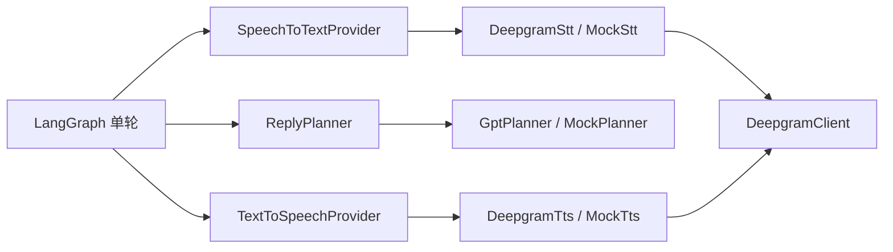

# Provider 的对象边界与调试

2026-10-31。以能力接口与组合为主，不建设通用插件平台、DI容器或继承层次。



`providers/types.ts`定义三个小接口：识别器接收规范化WAV并返回Transcription（文本、模拟标记、可选request ID/时长）；Planner返回待Graph校验的unknown计划；合成器返回AudioData（字节、MIME、可选request ID）。每个对象都有只含provider/model的info供诊断，不能打印整个适配实例或其私有配置。

`ProviderSet`仅组合 `stt? / planner / tts`。`providers/index.ts`是唯一按已校验配置选择适配器的组合入口。当前Live选择DeepgramStt、GptPlanner、DeepgramTts；Mock使用三个独立Mock类。显式disabled省略stt，HTTP层由实际对象能力生成会话/快照的voiceInput，而不是由APP_MODE猜测。

`DeepgramClient`只负责官方HTTP传输、共享Token鉴权、有限响应体、取消/超时、HTTP状态与request ID。`deepgram/stt.ts`和`deepgram/tts.ts`分别拥有/v1/listen JSON与/v2/speak MP3契约、模型和预算；一个接口变化不会迫使另一个类解析其数据。`openai/planner.ts`保留用户GPT配置，所有调用（含诊断与修复）仍在LangGraph节点内。媒体格式校验在 `media/audio-format.ts`，存储层不依赖模型SDK。

## 替换与受控调试

服务入口已经接受 `createApp({providers})`。添加新供应商时实现对应接口，在测试或开发组合时只换一个对象：

```ts
const defaults = createProviders(config);
const providers: ProviderSet = { ...defaults, stt: new AnotherStt(options, transport) };
const app = await createApp({ config, providers });
```

无需改Graph、路由、轮次、播放或角色。正式支持一个新配置选项时，再扩展配置枚举与唯一factory；未知供应商配置明确拒绝，不静默映射到另一家。禁止让模型输出决定Provider、URL或凭证。

新增STT的最低契约：规范化WAV输入、空白/非法响应拒绝、长度限制、正确模拟标志、AbortSignal全程传递、超时与取消后的迟到结果丢弃、供应商状态/请求ID可诊断但不泄漏正文。TTS还需状态/MIME/大小/音频签名与实际浏览器解码；Planner需共享ReplyPlan/剧情校验与最多一次修复。

复用入口：`deepgram/deepgram.test.ts`覆盖HTTP与失败契约；`composition.test.ts`实际用另一个识别器通过同一Graph/GPT/TTS；`live-input.test.ts`覆盖HTTP/Graph三段链路；`tests/e2e/deepgram.spec.ts`使用真实录音、受控供应商HTTP响应与可播放MP3验证浏览器。测试和CI不访问付费服务。

## 诊断与观测

`npm run providers:probe -- --stage capabilities`默认离线；显式stt/plan/tts逐阶段命令见[配置说明](../provider-configuration.md)。样本有时长/大小限制，调用有45秒总上限，探测不自动重试。单阶段诊断只要求该阶段凭证（如STT不需要GPT key）；正式应用仍校验完整Live配置。业务Graph记录每阶段选中的provider/model、耗时和可用request ID；错误只记录安全code/status/retryable，不输出对话、录音、鉴权头或Provider正文。没有真实usage则继续写unknown，不推导成本。

当前采用按住录音的REST链路和逐句合成；WebSocket流式输入、VAD及全双工是另一个交付范围。未来流式Provider需要独立流式接口，不能用现在的Promise接口伪装为完整流式协议。

Planner 的输出还包含 `suggestions`（用户下一条发言的label/draft列表），与角色回复同次生成、同样由共享schema校验和最多一次修复；不增加独立recommendation provider或额外LLM请求。MockPlanner提供模拟候选，Live由GPT结合PlanInput中的text/history/facts与本次回复规划生成。候选不会被TTS朗读或自动提交给planner。

## 语音输入失败与连接状态

Deepgram HTTP200空transcript保留为NO_SPEECH，公开映射为422，不再混入INVALID_REQUEST/400。预览失败只终结自己的turn，语音输入错误有独立投影，connected和sessionExpired不因此改变；用户可重录或直接发送文字。音频收尾先等最终编码块，再释放tracks，2秒无完成事件则关闭设备并丢弃迟到结果。

解码后仅记录整体RMS/峰值dBFS与数字静音标记；真实录音与转录不进入日志、源码或报告。没有以音量门限拒绝合法轻声，也没有把输入能量直接等同语音。Provider/model/language可通过离线capabilities查看；这不证明真实录音已恢复。

## Ink上下文与私有规划输出

PlanInput额外接受场景提供的systemPrompt与allowedActions，供应商适配不持有具体咖啡馆剧情。请求使用PlannerOutputSchema，在当前非explicit动作集合上约束actionId；Graph验证后分流普通回复与Ink beat。推荐kind/relatedActionId用于内部过滤，公开仍为label/draft。模板和actor的世界操作由scenario授权，不能由模型任意设置。

## 2026-11-01 移除Mock语音

场景Mock工厂只提供识别/规划，不再提供TTS。`createProviders`统一使用真实DeepgramTts，包括选择Mock会话适配器时也不创建模拟声音；实际发声需要真实Deepgram配置。没有text.ready或新文字替代通道，Live失败不回退Mock。原有用户主动选择的音频故障字幕恢复保持不变。CI应继续通过已有依赖注入测试替身隔离外部调用，不调用付费Provider。
