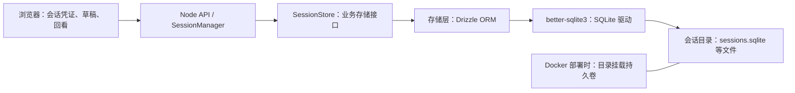

# 会话持久化设计草案

2026-11-02。状态：待审阅，尚未实施。本轮只编写设计，不安装依赖、不创建数据库、不修改服务或部署配置。

## 1. SQLite 和持久卷分别做什么

SQLite 是嵌入在 API 进程中的数据库引擎。API 通过它执行 SQL，把会话和剧情状态写入服务器磁盘上的数据库文件。它不需要另起数据库服务，也不需要单独的数据库端口或账号。

持久卷是 Docker 管理的一块独立于容器生命周期的数据存放位置。容器里运行 API，数据库文件写进挂载目录；容器重启或替换后，新容器挂载同一个卷，就能读到原来的文件。

两者的分工：SQLite 负责数据库结构、查询和事务；持久卷负责保留 SQLite 写出的文件。



| 运行方式           | 数据放在哪里                             | 停止后如何恢复                                         |
| ------------------ | ---------------------------------------- | ------------------------------------------------------ |
| 本地 `npm run dev` | 固定的 `apps/server/data/sessions/` 目录 | API 再次启动，读取同一目录中的数据库；不需要 Docker 卷 |
| Docker 部署        | 容器的会话目录挂载到 Docker 命名卷       | 新容器继续挂载原卷，读取同一个数据库                   |

项目现有 `mira-media` 卷只挂载 `/app/apps/server/data/media`。会话仍在内存 Map 中，现有卷不会自动保存它们。

拟新增独立会话卷，示意配置如下；这段还没有写入实际 Compose：

```yaml
services:
  api:
    volumes:
      - character-sessions:/app/apps/server/data/sessions

volumes:
  character-sessions:
```

原媒体卷继续保留。会话目录与媒体目录分开，媒体到期清理不会触及数据库。

持久卷随同一台宿主机保留。删除卷会删除其中的数据；迁移服务器仍需要迁移卷或恢复备份。它本身不提供异地备份。

## 2. 数据访问边界与 ORM 选型

数据库增删改查统一收在存储层。路由、Graph、Provider 和前端使用业务接口；SQL、Drizzle 查询、表模型及驱动类型集中在 SQLite 存储实现中，迁移工具配置作为开发侧入口。

本轮根据维护诉求，将**Drizzle ORM + better-sqlite3**列为推荐方案，待审阅。上一版“运行时新增依赖为 0”只适用于直接使用 Node 内置模块的方案；采用 ORM 后依赖清单相应变化。两种方案都使用 SQLite 文件和相同的持久卷，数据保存目标不变。

| 方案                                 | 新增依赖                                     | 适用取舍                                                     |
| ------------------------------------ | -------------------------------------------- | ------------------------------------------------------------ |
| Drizzle ORM + better-sqlite3（推荐） | 运行时 2 个、开发依赖 2 个                   | 类型化查询、统一表定义、版本化迁移，数据库访问仍封装在存储层 |
| Node 内置 node:sqlite + 手写 SQL     | 无新增运行时数据库包，需对齐现有 Node 类型包 | 依赖更少，需要自行维护 SQL、结果映射和迁移管理               |

### 推荐方案的依赖

| 包                      | 类型     | 用途                           |
| ----------------------- | -------- | ------------------------------ |
| `drizzle-orm`           | 运行时   | 类型化查询、表映射和事务接口   |
| `better-sqlite3`        | 运行时   | SQLite 驱动，执行数据库操作    |
| `drizzle-kit`           | 开发依赖 | 根据表定义生成可审阅的迁移文件 |
| `@types/better-sqlite3` | 开发依赖 | 驱动的 TypeScript 类型         |

2026-11-02 核对的 npm 稳定版本为 drizzle-orm 0.45.4、drizzle-kit 0.31.11、better-sqlite3 13.0.3、@types/better-sqlite3 9.6.0。这些是设计候选版本，尚未安装或完成组合运行验证；实施时需在 Node 26.13.0、macOS 和实际 Linux 镜像上验证并锁定精确版本。

better-sqlite3 13.0.3 声明支持 Node >=22，并包含原生模块。实施时要验证目标平台的安装与构建路径，不能只凭版本范围认定已验收。现有 `@types/node` 不因该驱动直接要求改用 Node 新增的 `Database` 接口。

需要区分官网新接口与已发布稳定包：当前 Drizzle 的 node:sqlite 接入文档要求 `drizzle-orm@rc` / `drizzle-kit@rc`；核对的稳定版 0.45.4 有 better-sqlite3 适配器，没有 node-sqlite 导出。因此本设计推荐稳定版 Drizzle 搭配 better-sqlite3，不默认组合 Drizzle RC 与 Node 内置接口。

作为备选，Node 26.13.0 的 `node:sqlite` 自身也标为 Stability 1.2 / Release candidate。该版本公开的同步接口叫 `Database`，`DatabaseSync` 是保留兼容的弃用别名；项目现有 Node 类型包仍声明旧名称。保留该路线时需要单独核对类型与接口版本。

Drizzle 能减少手写 SQL 和字段映射，但业务校验、Zod 网络契约、回执提交时机、旧轮身份判断和故障恢复继续由项目代码负责。数据库 schema 不代替 `packages/protocol` 的严格输入校验。

所选同步驱动仍会占用 Node 主线程。首版采用短事务、有界快照和按事件组批量提交，不逐 token 或音频样本写入；GPT、TTS、ComfyUI 和任何网络等待都不放在数据库事务里。需要更高并发时，再评估数据库 Worker 或独立数据库服务。

## 3. 文件和连接方式

拟定配置：

```dotenv
SESSION_STORE=sqlite
SESSION_DB_PATH=/app/apps/server/data/sessions/sessions.sqlite
SESSION_TTL_SECONDS=0
```

本地开发的默认路径解析到项目固定目录，不随启动工作目录改变。测试可显式选择内存存储或临时数据库。配置选择 SQLite 后，数据库无法打开、迁移失败或写入失败都应明确报错，不能静默改用内存。

会话目录可能包含：

```text
data/sessions/
  sessions.sqlite
  sessions.sqlite-wal
  sessions.sqlite-shm
```

SQLite 的 WAL 模式可能把已提交的事务暂存在 `-wal` 文件中。因此挂载整个目录；备份使用 SQLite 备份接口生成一致性副本，不能在数据库运行时只复制主文件并遗漏 WAL。

建议启用外键、WAL 和 `synchronous=FULL`，使用有界的锁等待，由存储层通过 ORM 的参数化查询访问。PRAGMA、特殊条件更新和迁移中需要直接 SQL 时，也限定在这个目录中。首版限定一个 API 实例访问本地磁盘；不把 WAL 数据库放到多机共享的网络文件系统上。

数据库文件、凭证摘要、对话和剧情存档都留在服务端数据目录，不进入 Git、前端包或普通日志。原始录音不在本方案中持久化。

## 4. 保存哪些数据

以下是逻辑表草案，具体字段与索引在实现前细化：

| 表                     | 主要内容                                                                                             | 用途                                     |
| ---------------------- | ---------------------------------------------------------------------------------------------------- | ---------------------------------------- |
| `sessions`             | 会话 ID、token 摘要、入口、状态、generation、完整 Ink checkpoint、故事版本与 artifact hash、到期时间 | 重启后继续认证原会话并恢复剧情           |
| `messages`             | 稳定 messageId、玩家文字或动作、顺序、消息状态                                                       | 保留玩家发言，区分消息与执行尝试         |
| `turns`                | turnId、generation、inputId、输入摘要、messageId、执行状态、取消/冻结状态                            | 防止重复输入，隔离旧轮与新轮             |
| `presentation_targets` | 已下发目标、顺序、依赖、候选 checkpoint                                                              | 服务器重启后仍能验证客户端补交的呈现回执 |
| `receipts`             | receiptId、目标、状态、呈现模式、去重摘要                                                            | 幂等确认已经发生的内容                   |
| `image_jobs`           | shareId、任务阶段、关联 ID、远端任务 ID、呈现记忆                                                    | 重启后核对原任务，避免重复提交出图       |
| `media_assets`         | assetId、归属、类型、存储键、有效期                                                                  | 让已有私有图片能重新定位和鉴权           |

另有轻量的数据库迁移记录，管理表结构版本。剧情的故事版本/hash 和数据库结构版本分别管理。

剧情依据仍是服务端确认的 checkpoint。地点、道具、关系等公开投影由它恢复；浏览器对话文字不能直接改写这些事实。模型上下文只使用已确认的历史，未完成的失败消息仍可保存在消息记录中。

不序列化 AbortController、定时器、连接、播放器实例或正在执行的 Promise。生成音频继续按媒体有效期管理，恢复会话不会自动重播旧声音。

## 5. 何时保存，如何恢复

### 正常交互

1. 创建会话落库成功，才返回会话凭证。
2. 新轮身份和输入去重记录落库成功，才确认 begin。
3. 呈现目标及其依赖先落库，再通过 SSE 发给前端。否则前端已经展示、服务端却没有目标记录，重启后就无法确认。
4. 回执去重、checkpoint、已确认历史在同一事务中更新。提交成功后才返回 acknowledged；写入失败不能把界面当成已经保存。

SessionManager 继续独占事实提交。数据库是权威存储，Map 可以作为缓存；事务失败时，缓存也不能提前暴露新剧情。

### 网络恢复和服务重启

浏览器沿用原 sessionId/token。API 从数据库读取会话、核对凭证，先合并真实回执，再返回快照。服务器不因为进程重启就要求建立新会话。

重启前未结束的轮次标记为中断，保留已下发目标和首次回执对账所需状态。先接收浏览器已经记录的冻结回执，再确定最终已确认进度；不自动重新提交玩家输入或重新调用付费供应商。

消息操作拟按事实区分：完全未呈现且符合重试条件时，可重试同一 messageId；已经部分呈现时，保留进度并继续对话。首版恢复到最后确认的剧情点，精确续播半句话作为后续能力。

图片任务需要用已保存的关联 ID/远端任务 ID 查询原任务；提交结果未知时保持待核对，不能因 API 重启就再次出图。已有图片重新加载不产生新的呈现事实。

### 明确重新开始

同一事务结束旧会话并创建新会话，凭证和状态分别归属各自的会话。重开请求增加幂等请求标识，网络重试只得到同一次重开的结果，避免重复创建空会话。偏好继续留在浏览器。

进程正常关闭只释放连接和任务资源，不删除数据库中的会话。现有 close/remove 路径需要拆分“关闭进程”和“用户结束会话”，图片资源清理也必须遵守这个区别。

### 故事版本变化

首版保证相同故事版本/hash 下跨重启恢复。故事包升级时进行兼容校验；不兼容存档不能直接加载到新 Ink 产物。兼容发布、旧包保留或存档迁移需要单独定义，不能把所有版本变化都当作数据库损坏或网络错误。

## 6. 计划改动范围与验收

预期新增存储接口、SQLite 适配器、数据库迁移和恢复逻辑；调整 SessionManager 的事务边界、应用启动/关闭流程、图片与媒体索引恢复。部署时新增会话卷和目录权限，浏览器仍保留当前凭证、草稿和阅读记录。

### 6.1 CRUD 集中在哪些文件

拟定目录如下，尚未创建：

```text
apps/server/src/persistence/
  ports.ts                    # 业务存储接口，无 ORM 类型
  sqlite/
    connection.ts             # 打开/关闭数据库、PRAGMA
    schema.ts                 # Drizzle 表定义与索引
    session-store.ts          # 会话、轮次与回执的事务实现
    image-store.ts            # 图片任务的持久化
    media-store.ts            # 私有媒体索引
    migrations/               # 版本化 SQL 迁移
```

业务层调用按业务事务命名的接口，例如 `loadSession`、`commitTurnStart`、`recordIssuedTargets`、`commitPresentation`、`restartSession`。`commitPresentation` 在同一事务内处理回执去重、剧情 checkpoint 和已确认历史，业务调用方不逐表拼接增删改查。

SessionManager 判断什么可以提交并准备下一份状态，存储层执行持久化与条件更新。业务代码和 Graph 不接收 Drizzle 的 db/tx 对象，不直接 import 表定义；迁移文件和工具配置集中管理。实施时在模块边界检查中约束 ORM/驱动的导入位置。

### 6.2 改动大小

整体评估为**集中在后端的中等规模改造**。安装 SQLite 驱动和定义表本身较小，较多工作在已有状态变化转成可恢复的事务，以及维护现有取消/回执规则。

| 范围                 | 预计改动   | 原因                                                                                                |
| -------------------- | ---------- | --------------------------------------------------------------------------------------------------- |
| 存储层、表定义、迁移 | 新增，中等 | 形成独立的数据库访问边界                                                                            |
| SessionManager       | 主要改造点 | 创建、begin、issued targets、回执、取消、重开和恢复需要对应持久化边界；不能只在正常结束时 save 一次 |
| 路由与 Graph         | 少量调整   | 路由继续调用 Manager；Graph 中直接修改 turn 状态的少量位置改为业务方法，LLM 编排和 Ink 逻辑保留     |
| 图片任务与媒体索引   | 中等       | 目前也在内存，需区分进程停止、用户取消和任务结果未知                                                |
| 前端与协议           | 少量调整   | 保留界面与播放调度，细化恢复原因、消息状态和重开幂等标识                                            |
| 部署                 | 少量调整   | 新目录/持久卷、权限、迁移入口与备份                                                                 |
| 回归验证             | 必要工作   | 验证重启、崩溃窗口、回执补交、幂等和旧回调隔离                                                      |

首个实施阶段聚焦会话、剧情、消息、回执与重启恢复；随后接图片任务和媒体索引。阶段一不能宣称图片已跨重启恢复，未对账的旧任务也不能直接重新提交。两阶段都不要求重写前端、故事脚本或 Provider 实现。

### 6.3 验收范围

这份草案不修改当前实现状态。实施后的验收应包括：

- API 重启、浏览器刷新、容器替换并复用原卷后，同一会话仍可认证并恢复已确认进度。
- 目标发布后/回执确认前崩溃，恢复时能补交回执且只提交一次。
- checkpoint 和历史写入失败时不返回成功确认；恢复后不出现一半新、一半旧的剧情。
- 未完成消息、部分呈现消息和完全完成消息显示不同的恢复操作。
- 重开请求网络重试只建立一个新会话，旧取消/迟到回调不能影响新会话。
- 正常停服务不删除存档或已保存图片；未知出图任务不自动重复提交。
- 数据库损坏、卷未挂载或版本不兼容时有明确错误，不静默新建空存档。

上述功能、运行时和 E2E 验收需要另行明确要求后执行，遵守当前 AGENTS 限制。已经丢失的旧内存进度无法通过新建数据库自动找回。

## 参考

- [Node 26.13.0：SQLite API 与稳定性状态](https://nodejs.org/docs/v26.13.0/api/sqlite.html)
- [SQLite：WAL 模式与文件一致性](https://www.sqlite.org/wal.html)
- [Docker：Volumes](https://docs.docker.com/engine/storage/volumes/)
- [Drizzle：SQLite 驱动选择](https://orm.drizzle.team/docs/get-started-sqlite)
- [Drizzle：Node SQLite 接入及 RC 安装说明](https://orm.drizzle.team/docs/connect-node-sqlite)
- [Drizzle ORM 0.45.4 的 npm 包元数据](https://registry.npmjs.org/drizzle-orm/0.45.4)
- [better-sqlite3 官方说明](https://github.com/WiseLibs/better-sqlite3)
